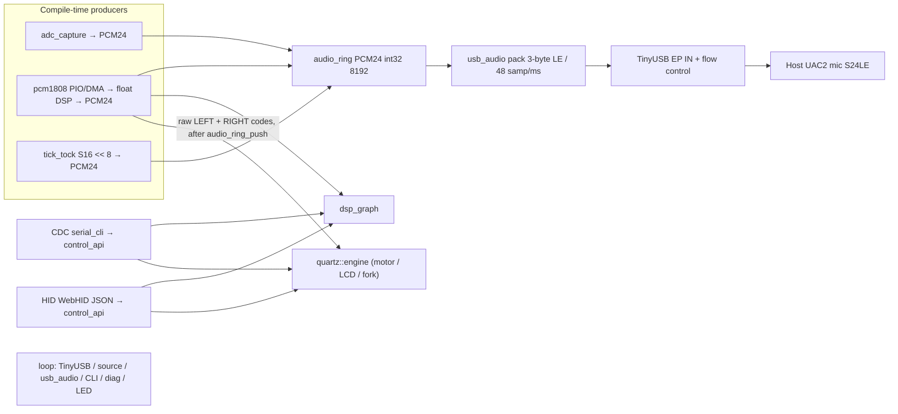

# As-Built Architecture Spec

This document describes the **firmware as implemented**. Use it to align external / parallel spec docs with reality. Where behavior differs from [`IMPLEMENTATION_SPEC.md`](../IMPLEMENTATION_SPEC.md) or older handoff notes, **this file wins** for “what the code does.”

---

## 1. Purpose

USB recording device that appears to a host as a **UAC2 mono microphone** at **48 kHz, signed 24-bit little-endian (3 bytes/sample), 1 channel**, for watch-tick capture and timing DSP evaluation.

Three compile-time audio sources (`-DAUDIO_SOURCE=…`):

| Source | Role |
|---|---|
| **ADC** | RP2350 onboard SAR ADC → DMA → oversample/DC/scale → **PCM24** ring → USB |
| **PCM1808** | External PCM1808 I²S (PIO + DMA) → float DSP graph → **PCM24** ring → USB |
| **SYNTHETIC** | Looped S16 `tick-tock.wav` table, MSB-aligned into PCM24 → USB (host/USB validation) |

**RP2350 / RP2354 only.** RP2040 PlatformIO environments have been removed.

**Two modalities.** The device runs in one of two persisted modes (§4.3): **USB microphone** (default; a host records the audio and capture follows the USB stream) or **standalone timegrapher** (capture and analysis run on their own from boot, results on the OLED, CLI and HID; the USB audio feed is silent). A run latch (`start` / `stop`) also lets a USB-mic device measure without a stream. The web front end is the sibling repo `timegrapher-web` (WebHID, with a virtual device for development).

**Quartz-watch timing (PCM1808 builds only).** The PCM1808 is a stereo ADC, and both channels are decoded. **LEFT** carries the inductive pickup (coil, OUT_IND) and **RIGHT** the capacitive pickup (electrode, OUT_CAP). The USB microphone and the mechanical DSP graph use **LEFT only**, so the host still sees one mono channel. A separate quartz engine (§8.5) times stepper-motor pulses and tuning forks on LEFT and LCD drive on RIGHT, from the raw 24-bit codes. It is selected at run time by the quartz mode (`mechanical` at boot, which leaves the engine idle). On ADC and SYNTHETIC builds the mode stays `mechanical`. Only the engine's name tables are linked there; the pipelines and their ~41 KB store are dropped. User guide: [QUARTZ_TIMING.md](QUARTZ_TIMING.md).

---

## 2. Toolchain and boards

### 2.1 Build system

| Item | As built |
|---|---|
| Build | **PlatformIO** |
| Platform | `https://github.com/maxgerhardt/platform-raspberrypi.git` |
| Framework | **Arduino** (`board_build.core = earlephilhower`) |
| USB stack | Adafruit TinyUSB (`-DUSE_TINYUSB`), `lib_archive = no` |
| DSP lib | Vendored **CMSIS-DSP** (`third_party/CMSIS-DSP`), `ARM_MATH_CM33`, framework softfp ABI |
| Language | C++ application modules + C-style APIs; Arduino `setup()` / `loop()` |
| RTOS | None |
| Second core | Core 1 runs only the SH1107 128×128 OLED readout (`setup1`/`loop1` → `display_ui`), reading a seqlocked `ui_snapshot` that core 0 publishes. Core 0 keeps everything time-critical (TinyUSB, capture, DSP, CLI, HID). Built with `DISPLAY_SH1107=0`, core 1 is held in reset. See [DISPLAY.md](DISPLAY.md) |

**Not used:** pure Pico SDK CMake project without Arduino.

### 2.2 Environments (`platformio.ini`)

| Env | Board ID | Package | Flash | ADC GPIO | `AUDIO_SOURCE` |
|---|---|---|---|---|---|
| `pico2` | `rpipico2` | RP2350A | board default | **26** | ADC |
| `pico2_synthetic` | `rpipico2` | RP2350A | board default | 26 | SYNTHETIC |
| `pico2_pcm1808` | `rpipico2` | RP2350A | board default | 26 | PCM1808 |
| `kiwi` | `generic_rp2350` | RP2350B (`__PICO_RP2350A=0`) | **2 MB** | **40** | ADC |
| `kiwi_synthetic` | `generic_rp2350` | RP2350B | **2 MB** | 40 | SYNTHETIC |
| `kiwi_pcm1808` | `generic_rp2350` | RP2350B | **2 MB** | 40 | PCM1808 |

Kiwi upload/debug: `picoprobe`. Status LED: **GPIO 25** on Pico 2 and Kiwi. Every env builds the OLED (`DISPLAY_SH1107=1`; SDA/SCL GP4/GP5 on Pico 2, GP6/GP7 on Kiwi). CI builds `pico2_pcm1808`, `kiwi_pcm1808`, `pico2` and `pico2_synthetic`.

Optional features are build flags, not envs: `-DPPS_GPIO=N` (GPS 1 PPS input; set to **3** in `pico2_pcm1808` only), `-DGPS_UART_RX=N` (NMEA input; set in **no** shipped env, so `caps.gps` is false by default), `-DDIAG_UART=1`, `-DBOOST_SWITCH_PRESENT=1`, `-DDISPLAY_SH1107=0`. See [TIMEBASE_CALIBRATION.md](TIMEBASE_CALIBRATION.md) for the GPS flags.

PCM1808 pins: **Pico 2 PCB** MCLK **GP21**, LRCK **GP20**, DOUT **GP19**, BCK **GP18**; **Kiwi / legacy** MCLK **GP21**, BCK **GP2**, LRCK **GP3**, DOUT **GP4**. PIO wait immediates are board-baked (`pcm1808_i2s_pico2` vs `pcm1808_i2s_legacy`). See [`PCM1808_WIRING_AND_CLOCKS.md`](PCM1808_WIRING_AND_CLOCKS.md).

### 2.3 TinyUSB config mechanism

`CFG_TUSB_CONFIG_FILE` is unreliable under PlatformIO (project `include/` is not first for library compiles). TinyUSB is configured **only** by the `-DCFG_TUD_*` flags in `platformio.ini` (the former `include/tusb_config.h` mirror was removed; it was never compiled). `usb_descriptors.cpp` asserts `CFG_TUD_AUDIO_FUNC_1_DESC_LEN` against the real descriptor length.

Key audio flags: `N_BYTES_PER_SAMPLE_TX=3`, `EP_SZ_IN=147` (49×3), `EP_IN_SW_BUF_SZ=588`, `EP_IN_FLOW_CONTROL=1`.

---

## 3. Source tree

```text
timegrapher-stand/
  platformio.ini
  tick-tock.wav
  IMPLEMENTATION_SPEC.md
  README.md / LICENSES.md
  include/
    app_config.h              # rates, ring, ADC/PCM1808 knobs, PCM24 limits
    board_config.h            # board name, pins, BOOST_SWITCH, PCM1808 pins
    tick_tock_pcm.h           # generated S16 table (SYNTHETIC)
    audio_ring.h              # PCM24 int32 ring + 3-byte pack helper
    audio_source.h            # stream FSM
    adc_capture.h / pcm1808_*.h / pcm1808_format.h
    pcm1808_rate.h            # measured frame rate → MCLK ratio / USB repeat
    mechanical/               # mechanical-watch analysis (internal to dsp_graph)
      tick_detect.h           # event_detect: tick windows, unlock/drop landmarks
      beat_analysis.h         # beat_rate: lock, rate, BE, amplitude, averages
      beat_fit.h              # least-squares rate + beat-error fit
    quartz/                   # quartz-watch timing (C++17, host-testable)
      quartz_engine.h         # firmware owner: mode, gating, params, snapshot
      quartz_types.h          # result structs, status enums, fork list, ppm helper
      quartz_dsp.h            # 400 Hz HPF, exact-phase DFT/Goertzel, unwrap, line fit
      motor_timing.h          # motor: detector, timestamps, segmented LS fit
      lcd_timing.h            # LCD: pattern search + harmonic phase tracker
      tone_timing.h           # tuning fork (and 32 768 Hz crystal) tone phase
    dsp_quartz_types.h        # C POD view of the engine (control_api, ui_snapshot, HID)
    hid_json.h                # host-testable HID JSON encoders (quartz payloads)
    timebase.h / pps_filter.h # crystal ppm calibration (flash, NTP, GPS PPS), GPS detail (timebase_gps_t)
    timebase_log.h            # calibration history: ring, flash record, PPS log policy (header-only)
    nmea.h                    # NMEA 0183 parser: RMC / GGA / GSA / GSV, multi-GNSS (header-only)
    device_mode.h             # device mode, run latch, log threshold (DEVICE flash region)
    flash_store.h             # single owner of the 1 KB EEPROM-emulation flash image
    ui_snapshot.h / display_ui.h / ui_format.h  # core 0 → core 1 OLED readout
    pps_counter.pio.h         # generated: scripts/gen_pps_pio.py
    usb_audio.h / diagnostics.h / power_control.h
    dsp_types.h / dsp_graph.h / control_api.h / perf_timing.h
    dsp_blocks.h              # block + parameter name table (CLI / HID / faults)
    fw_identity.h             # FW_VERSION, USB VID/PID, USB strings
    hid_control.h             # WebHID framer / RPC entry points
    serial_cli.h / cli/*.h
    cli/quartz_format.h       # pure quartz CLI parsers / formatters (host-tested)
    cli/device_format.h       # pure device / run / beats / graph / GPS / log CLI formatters (host-tested)
  src/
    TimegrapherStand_main.cpp # setup/loop: power, USB, CLI, LED
    usb_audio.cpp             # UAC callbacks, 1 ms PCM24 feed
    usb_descriptors.cpp       # Adafruit_USBD_Interface → mic descriptors
    audio_source.cpp          # FSM + ADC / PCM1808 / SYNTHETIC
    audio_ring.cpp
    adc_capture.cpp
    pcm1808_capture.cpp / pcm1808_clock.cpp
    # PIO: scripts/pcm1808_i2s.pio.in → include/pcm1808_i2s_{pico2,legacy}.pio.h
    dsp_graph.cpp / dsp_blocks.cpp / control_api.cpp / perf_timing.cpp
    mechanical/tick_detect.cpp / mechanical/beat_analysis.cpp
    mechanical/beat_fit.cpp
    quartz/quartz_engine.cpp
    quartz/quartz_dsp.cpp / quartz/motor_timing.cpp
    quartz/lcd_timing.cpp / quartz/tone_timing.cpp
    hid_control.cpp           # vendor HID framing + JSON RPC -> control_api
    hid_json.cpp              # HID JSON encoders (hello caps + pipeline, device, beats, GPS, log, quartz)
    timebase.cpp              # calibration, PPS, GPS, timebase log policy + deferred write
    device_mode.cpp / flash_store.cpp
    ui_snapshot.cpp / display_ui.cpp   # display_ui runs on core 1
    serial_cli.cpp / cli/cli_core.cpp / cli/cli_commands.cpp
    diagnostics.cpp / power_control.cpp
  third_party/CMSIS-DSP/      # vendored CMSIS-DSP sources (incl. arm_mult_f32.c for quartz)
  scripts/
    calibrate_timebase.py     # NTP calibration over the CDC `time` command
    gen_tick_tock_pcm.py      # tick-tock.wav -> include/tick_tock_pcm.h
    gen_pcm1808_pio.py        # pcm1808_i2s.pio.in -> include/pcm1808_i2s_{pico2,legacy}.pio.h
    gen_pps_pio.py            # pps_counter.pio.in -> include/pps_counter.pio.h
  .github/                    # workflows/ci.yml, workflows/codeql.yml, dependabot.yml
  docs/
    AS_BUILT_ARCHITECTURE.md  # this file
    HID_CONTROL_PLANE.md      # WebHID/JSON control spec (H0; firmware H1+)
    hid/timegrapher_hid.d.ts  # TypeScript contracts
    hid/webhid_example.md     # browser sketch
    hid/example.html          # minimal WebHID smoke page
    TIMEBASE_CALIBRATION.md   # clock calibration, GPS PPS / NMEA, calibration log, flash layout
    DISPLAY.md                # OLED readout, wiring, troubleshooting
    PCM1808_WIRING_AND_CLOCKS.md
    build_and_flash.md
    PORTING_TO_PCM1809.md
    acceptance_results.md
    CHANGELOG_PCM1808.md      # running changelog (PCM1808 backend and later)
    IMPLEMENTATION_SPEC.md / CODEGEN_PROMPT.md  # historical P3.0 spec and prompt (superseded by this file)
    QUARTZ_TIMING.md          # quartz timing user guide: concepts, CLI, HID, display
    handoff/                  # quartz pickup handoff package (spec + reference)
      FIRMWARE_HANDOFF.md     # signals, algorithms, pitfalls, §9 acceptance table
      signal_spec.yaml / results.json
      ref/timing_ref.py       # executable reference the quartz library ports
      vectors/                # stereo 24-bit acceptance WAV + JSON truth
      gen/ / sim/ / figures/  # vector generator, circuit model, plots
    Watch_Timing_RP2350_RP2354_DSP_Handoff.md  # design intent (may lag code)
  tests/
    host_analyze.py           # S16 or S24 WAV stats
    host_capture.md
    test_pcm_conversion.c     # ADC → PCM24 mirror
    test_pcm1808_pcm_conversion.cpp  # includes include/pcm1808_format.h
    test_pcm1808_rate.cpp     # frame-rate → MCLK ratio classification
    test_beat_fit.cpp         # rate / beat-error fit (with src/mechanical/beat_fit.cpp)
    test_pps_filter.cpp       # GPS PPS period averaging
    test_ui_format.cpp        # OLED number formatting
    test_calibrate_timebase.py  # NTP calibration fit (scripts/calibrate_timebase.py)
    test_ring_buffer.c
    test_nmea.cpp             # GPS NMEA parsing (incl. GSV / GSA / GGA)
    test_timebase_log.cpp     # calibration-log ring, flash record, PPS policy
    test_device_cli_format.cpp  # device / run / GPS / log CLI formatters
    test_dsp_blocks.cpp       # block table and pipeline graph
    run_all.sh                # builds and runs every host test, PASS/FAIL/SKIP table (see below)
    build_quartz_tests.sh     # builds host CMSIS-DSP + runs the five quartz tests below
    test_quartz_units.cpp     # quartz library units (HPF, DFT, unwrap, timestamps, fits)
    test_quartz_vectors.cpp   # handoff §9 acceptance table on every vector
    test_quartz_engine.cpp    # engine: routing, gating, resets, gate, calibration
    test_hid_json.cpp         # HID JSON encoders (hello, device, beats, GPS, log, quartz), 2048-byte limit
    test_quartz_cli_format.cpp  # quartz CLI parsers / formatters
    wav24.h                   # stereo 24-bit WAV reader for the vector tests
```

---

## 4. Runtime architecture



**Channel use (PCM1808).** Each DMA block is decoded to LEFT and RIGHT sign-extended 24-bit codes. LEFT goes, as float full scale, through `dsp_graph_process` to the USB ring (mono, unchanged). After the block has been pushed to `audio_ring`, both channels' raw codes go to `quartz::engine::process()` with the same absolute source index. The engine reads LEFT in motor and fork modes and RIGHT in LCD mode, and does nothing in `mechanical` mode. It shares core 0 and the 5 ms block budget with the DSP graph, so a slow quartz block delays only analysis, never the audio already queued. `dsp_graph` forwards its stream reset, source-rate and timebase events to the engine (`quartz_hook_*` in `dsp_graph.cpp`, empty on non-PCM1808 builds). The CLI and HID reach the engine only through `control_api_*quartz*`. Every 100 ms, core 0 copies a quartz subset (`ui_quartz_t`) into `ui_snapshot` for the OLED.

### 4.1 Main loop ([`TimegrapherStand_main.cpp`](../src/TimegrapherStand_main.cpp))

1. `TinyUSBDevice.task()`
2. `audio_source_process()` — deferred capture start/stop, producer → ring, prefill→active
3. `usb_audio_task()` — once per `millis()`, write **48 PCM24 samples** (144 bytes) into TinyUSB
4. `serial_cli_tick()` — watchdog poll, async DSP errors, CDC line CLI
5. `hid_control_task()` — HID request dispatch, TX pump, subscribe pushes
6. `diagnostics_poll()` — ~2 s CDC/UART status line when enabled
7. `timebase_poll()` — PPS / NMEA drain, lock streak, calibration-log policy and deferred log write (§8.10)
8. `publish_ui_snapshot()` (10 Hz) and the status LED blink (rate depends on mount/stream; off while suspended)

Init in `setup()`, in this order: (`multicore_reset_core1()` only when there is no display) → `power_control_init()` → LED → `diagnostics_init()` → `control_api_init()` (DSP graph, before capture) → **`flash_store_init()`** (loads the 1 KB flash image; first, because the next two read it) → **`timebase_init()`** (stored calibration, log, PPS) → **`device_mode_init()`** (persisted mode and log threshold) → `audio_source_init()` → **`device_boot_run()`** (sets the run latch when the persisted mode is standalone) → `usb_audio_init()` → `serial_cli_init()`.

### 4.2 Stream state machine ([`audio_source`](../src/audio_source.cpp))

| State | Meaning |
|---|---|
| `USB_UNCONFIGURED` | Not mounted / disconnected |
| `USB_CONFIGURED_IDLE` | Enumerated; AS alt 0 (not recording) |
| `STREAM_PREFILL` | AS alt ≠ 0; filling ring toward `APP_RING_PREFILL_SAMPLES` (960 ≈ 20 ms) |
| `STREAM_ACTIVE` | Prefill met; USB feeder drains live audio |
| `USB_SUSPENDED` | Bus suspend; capture requested off, boost aborted |
| `STREAM_ERROR` | Backend init failed (e.g. PCM1808 MCLK / clk_sys check) |

Capture hardware start/stop is **deferred to the main loop** (never from TinyUSB control callbacks) so DMA abort cannot hang the USB stack.

Optional **preamp warm-up** (`power_control`, `PREAMP_SETTLE_MS`) runs before prefill when `BOOST_SWITCH_PRESENT=1`. Default builds leave the switch **unassigned** (`BOOST_SWITCH_PRESENT=0`) — warm-up is a no-op and capture starts immediately.

Suspend/resume: suspend aborts boost and drops capture; resume re-arms recording if the stream was still armed (unless the run latch, §4.3, keeps the device measuring).

**Capture no longer depends only on the USB stream.** Capture and analysis run while `usb_audio_streaming() || run latch`. Earlier firmware ran them only while the host had the audio stream open; the state machine above still describes the stream path, and a second path, the *run phase* (`Off` → `Warmup` → `On`, §4.3), drives capture without a stream.

### 4.3 Device mode, run latch and flash store

**Modes** ([`device_mode.h`](../include/device_mode.h), `device_mode.cpp`). `DEVICE_MODE_USB_MIC` (default) and `DEVICE_MODE_STANDALONE`. The mode is persisted. It is read once per capture block through `device_mode_get()`.

**Run latch** (`audio_source.cpp`: `g_run_requested`, volatile; set by `device_run_start()`, cleared by `device_run_stop()`; not persisted).
- `run_owns_pipeline()` is true when the latch is set and either no USB stream is armed or the bus is suspended. Only then is the run phase active: `run_supervise()` (called every `audio_source_process()` tick) arms it. `run_arm()` checks backend health (an unhealthy backend drops the latch), resets the ring and the ADC stats, and either warms the preamp (`Warmup`) or goes straight to capture (`On`). It never waits for a ring prefill.
- When the latch is cleared (or a stream arms) and the phase is not `Off`, `power_down()` stops capture and the preamp.
- `arm_recording()` (a USB stream opens) forces the phase to `Off`: the stream takes over.
- `audio_source_capture_running()` reports "capture running and processed" for either reason; it feeds `DeviceStatus.running`.

**Mode effects.** In standalone, `device_boot_run()` sets the latch at boot and `device_mode_set()` sets it when entering the mode (and clears it when entering USB mic). `audio_source_feeds_ring()` is `false` in standalone (and with no armed stream): the capture backends (`adc_capture`, `pcm1808_capture`, the synthetic generator) skip `audio_ring_push` and the 24 to 48 kHz repeat, and `usb_audio_task` sends zero-filled IN packets, not an underrun. A stream opened in standalone moves `PREFILL` to `ACTIVE` without waiting for the ring.

**Persistence.** `device_mode_set()` and `device_log_delta_ppm_set()` write one DEVICE-region record `{magic "DEV1", version, size, mode, logDeltaPpm, crc}`. They refuse (`DEVICE_SET_BUSY`) while the USB stream is open and keep the old value on failure.

**Flash store** ([`flash_store.h`](../include/flash_store.h), `flash_store.cpp`): the **only** code that calls `EEPROM.begin` / `EEPROM.commit`. Arduino-Pico emulates EEPROM with one 4 KiB sector; the 1024-byte logical image is edited in RAM and committed whole.

| Region | Offset | Size | Owner |
|---|---:|---:|---|
| TIMEBASE | 0 | 256 B | `timebase.cpp`: calibration record (unchanged from the 256-byte image) |
| DEVICE | 256 | 256 B | `device_mode.cpp`: mode + `logDeltaPpm` |
| TBLOG | 512 | 512 B | `timebase.cpp` / `timebase_log.h`: calibration log (404-byte record) |

Features call `flash_store_read` / `flash_store_write` (stage in RAM) and then `flash_store_commit_paused()`. That function refuses (`BUSY`) while USB audio streams; otherwise it pauses capture (`audio_source_capture_pause`), erases and reprograms the sector, reads it back and compares, and restarts capture (`audio_source_capture_resume`, a fresh stream: DSP and quartz state reset, beat `seq` restarts). It does nothing when no staged byte differs from flash. CRC-32 (IEEE) protects every record; erased `0xFF` fails the magic check and reads as "nothing stored". The pause is needed because a flash erase stalls execute-in-place for tens of milliseconds, which would wreck an isochronous stream or a PIO/DMA capture (core 1 is idled by Arduino-Pico's `EEPROM.commit`, so the display is safe).

---

## 5. USB audio (as built)

### 5.1 Device identity

| Field | Value |
|---|---|
| VID / PID | `0xCafe` / `0x4003` |
| Manufacturer | `TimegrapherStand` |
| Product | `Watch Timing Microphone` |
| Audio interface string | `Watchgrapher Studio Interface` |

### 5.2 Class / format

| Parameter | Value |
|---|---|
| Class | UAC2 |
| Direction | Recording only (EP IN); no EP OUT / feedback |
| Channels | 1 |
| Format | **PCM S24LE** (3 bytes/sample on the wire) |
| Rate | 48000 Hz only |
| `wMaxPacketSize` | **147** bytes (49 × 3) |
| Descriptor | `TUD_AUDIO_MIC_ONE_CH_DESCRIPTOR` with bytes/sample = 3, bit res = 24 |

Feature unit: mute + volume present for host compliance. **Mute zeros USB output; volume is not applied to PCM** (advertised 0…0 dB).

### 5.3 Composite with CDC

Adafruit TinyUSB Arduino requires CDC to link and always adds USB Serial.

**As built:** device enumerates as **CDC + UAC2 mic**. CDC carries the diagnostic stream and the interactive DSP CLI.

### 5.4 Stream open / close

- Open: `tud_audio_set_itf_cb` — low byte of `wValue` is alt setting; alt ≠ 0 starts streaming / arms source.
- Close: `tud_audio_set_itf_close_ep_cb` stops streaming and resets source.

While alt ≠ 0 but the FSM is still in PREFILL (or not ACTIVE), the feeder sends **digital silence** so ISO keeps running without draining an empty ring.

### 5.5 PCM feed to TinyUSB

- Application writes **exactly 48 mono PCM24 samples once per millisecond**, packed to 3-byte LE (`audio_pcm24_pack_le`).
- `CFG_TUD_AUDIO_EP_IN_FLOW_CONTROL=1` — TinyUSB chooses on-wire 47/48/49 sample sizes.
- Do **not** burst multiple frames into the FIFO (historical pitch/warp distortion).
- Ring underrun while ACTIVE: **hold last sample** (not zeros).
- Optional catch-up: if `loop()` stalls, feed at most a few missed 1 ms frames.

---

## 6. PCM ring buffer

| Parameter | Value |
|---|---|
| Capacity | 8192 samples (power of two) ≈ **171 ms** @ 48 kHz |
| Element | `audio_sample_t` = `int32_t` holding **signed PCM24** |
| Prefill target | 960 samples (~20 ms) |
| Model | Free-running indices; leave one slot empty |
| Producer | ADC convert, PCM1808+DSP, or synthetic |
| Consumer | `usb_audio` (48 samples / ms) |
| Overrun / underrun | Counted in diagnostics |

Wire packing (int32 → 3 LE bytes) happens only in the USB feeder, not in the ring.

---

## 7. Audio sources

### 7.1 SYNTHETIC

| Item | As built |
|---|---|
| Asset | `tick-tock.wav` — mono S16LE @ 48 kHz, 19192 frames (~400 ms) |
| Embed | [`tick_tock_pcm.h`](../include/tick_tock_pcm.h) via `scripts/gen_tick_tock_pcm.py` |
| To ring | Exact S16 sample **left-shifted 8 bits** into PCM24 container |
| Playback | Index 0…LEN-1, wrap; keep ring ≈ prefill + 10 ms ahead |

### 7.2 ADC

| Item | As built |
|---|---|
| API | Pico SDK `hardware_adc` + `hardware_dma` |
| Pins | Pico2: GPIO26 / ch0; Kiwi: GPIO40 / ch0 |
| Rate | Raw capture at `48 kHz × ADC_OVERSAMPLE` (default oversample **8**) |
| DMA | Ping-pong, 2 × (`240 × oversample`) raw samples; IRQ marks ready |
| DC | Learn midrail from first raw block when `ADC_DC_REMOVE=1` |
| Scale | `(centered * ADC_PCM_SCALE) << 8` → clamp to PCM24 (`ADC_PCM_SCALE` default **48**) |
| Optional LPF | `ADC_LPF_SHIFT` (default 0 = off) |
| DSP graph | **Not used** on this path today — PCM24 goes straight to the ring |

### 7.3 PCM1808

| Item | As built |
|---|---|
| Mode | Codec master I²S; MCU generates **MCLK ~12.288 MHz** on GP21 (`clock_gpio_init_int_frac16`, assumes **150 MHz** `clk_sys`). Pico 2 I²S: BCK GP18 / DOUT GP19 / LRCK GP20 |
| Capture | PIO RX SM + single DMA channel ping-pong (IRQ swaps buffers) |
| Block | 240 stereo frames (480 `uint32` slot words) per DMA buffer |
| Stereo decode | Both slots: arithmetic `>> 8` → sign-extended 24-bit (`pcm1808_slot_to_pcm24`). LEFT feeds the DSP graph and USB; LEFT and RIGHT raw codes are kept per block (`g_block_left24` / `g_block_right24`) for the quartz engine. Peaks are tracked per channel (`pcm1808_raw_left/right_peak_abs`); `pcm1808_saturated_count` counts LEFT only |
| Mono | USB carries LEFT only (unchanged) |
| Block order | The DMA IRQ stamps each completed buffer with a sequence number (`g_buf_seq`, the IRQ block count). The main loop takes ready buffers **oldest first** by signed sequence difference (wrap-safe), at most one pass per buffer per call. Index order would swap two blocks when the loop falls behind or after an overrun, which shows up as a fake 5 ms timing step |
| Lost blocks | A sequence gap means buffers were overwritten before being read. Their samples are gone, but the source index is **advanced by the lost frames** (gap × 240), so later samples keep their true absolute index, and `pcm1808_blocks_lost` counts them (diag line `lost=`). The beat fit then sees an honest gap rather than a step |
| DSP | Always through `dsp_graph_process` (float FS → PCM24) |
| Quartz | After `audio_ring_push`: on a sequence gap or a change of `pcm1808_dma_block_overruns`, `quartz::engine::notify_sample_loss()`, then `quartz::engine::process(left24, right24, 240, base)` with the same `base` index the graph received |
| Frame rate | **Measured**, not assumed. The DMA IRQ timestamps each block. Every 50 blocks the main loop computes frames/s and snaps it to SCKI/256, /384 or /512 (`pcm1808_rate.h`). Two agreeing windows (about 1 s) confirm a rate, which then sets the DSP source rate and the USB sample repeat (×1 at 48 kHz, ×2 at 24 kHz). The DSP timebase stays *unverified* until a rate is confirmed, or whenever the rate is unsupported (32 kHz) or unknown, and while it is unverified `beat_rate` will not lock. `PCM1808_OUTPUT_UPSAMPLE` (default 2) is only the guess used before the first confirmation. The result is shown by CLI `status` and in HID `beat.sourceHzMeasured` / `timebaseOk`. See [PCM1808_WIRING_AND_CLOCKS.md](PCM1808_WIRING_AND_CLOCKS.md). |
| Format helper | `pcm1808_slot_to_pcm24()` in `pcm1808_format.h` — used by the live capture path and the host test |

Boot checks `clk_sys == 150e6` and `clk_usb == 48e6`. MCLK starts in `audio_source_init()` so GP21 runs without opening a USB stream. Capture may defer until MCLK warmup / ready.

---

## 8. DSP graph (PCM1808 path)

Implemented in [`dsp_graph.cpp`](../src/dsp_graph.cpp) / [`dsp_types.h`](../include/dsp_types.h). The mechanical escapement analysis is split out into `src/mechanical/`: [`tick_detect`](../include/mechanical/tick_detect.h) (`event_detect`: event windows and unlock / drop landmarks), [`beat_analysis`](../include/mechanical/beat_analysis.h) (`beat_rate`: lock, rate, beat error, amplitude, rolling averages, and its parameters) and [`beat_fit`](../include/mechanical/beat_fit.h) (the least-squares fit). `dsp_graph.cpp` keeps the meters, noise floor, event-detect threshold (shared with `soft_gate`), matched filter, event log, process path, quantize and watchdog, and calls the mechanical modules once per block / per closed event. Host control goes through [`control_api`](../include/control_api.h) (CDC CLI now; HID-ready later).

### 8.1 Pipeline order

```text
PCM1808 left24 → float FS (/8388608)
  → analysis (meters, noise, match, event, beat, spectrum)  [never mutates PCM]
  → process  (notch → IIR filter → FIR → soft_gate → gain → AGC → limiter)
                                                            [only if bypass off]
  → quantize to signed PCM24 (int32)
  → repeat ×1 / ×2 (measured frame rate → 48 kHz)
  → audio_ring
then, per block:  raw LEFT + RIGHT codes → quartz::engine::process  (§8.5)
```

Master **bypass** defaults **on**: process path is identity; analysis may still run. When bypass is on, optional `PCM1808_PCM_GAIN` is applied at quantize. When bypass is off, loudness is the **gain** / **AGC** blocks.

CMSIS-DSP kernels: `arm_power_f32`, `arm_biquad_cascade_df1_*`, `arm_fir_f32`, `arm_dot_prod_f32`, `arm_rfft_fast_f32` (512).

### 8.2 Blocks

| Block | Path | Default | Behavior |
|---|---|---|---|
| `bypass` | Master gate | on | Process path skipped when on |
| `level_meter` | Analysis | on | Pre peak / RMS EMA |
| `noise_floor` | Analysis | on | EMA of RMS on quiet blocks (feeds detect / gate) |
| `event_detect` | Analysis | on | Threshold × noise; hysteresis; max 80 ms; min-peak gate |
| `beat_rate` | Analysis | on | Unlock intervals → vph, daily rate s/d, beat error ms, amplitude ° |
| `event_log` | Analysis store | (ring) | Last `DSP_EVENT_LOG_CAP` (32) events (rise/snr/energy) |
| `notch` | Process | off | Narrow RBJ notch at 50 or 60 Hz |
| `filter_bank` | Process | off | Cascaded one-pole HPF+LPF presets (wide/medium/narrow) |
| `soft_gate` | Process | off | Fast open on impulses; release toward `floor_db` between ticks |
| `gain` | Process | off | Fixed make-up gain from `db` param |
| `agc` | Process | off | Slow peak follower toward `target` FS (τ seconds; ±12 dB) |
| `limiter` | Process | on | Hard clamp at ±1.0 FS before PCM24 quantize |
| `matched_filter` | Analysis | off | 64-sample learned template + correlation gate for event opens |
| `fir_bank` | Process | off | 64-tap Hamming FIR bandpass (same presets as filter_bank) |
| `spectrum` | Analysis | off | 512-point RFFT; top-8 tonal peaks (`dsp spectrum`) |

Enabling process blocks (**notch / filter / fir / soft_gate / gain / agc / limiter**) **clears master bypass** and arms the USB continuity watchdog.

CLI: `dsp help <block>` prints a short description and params; aliases include `on`/`off`, `gate`, `filter`, `event`, `dsp set gain 12`, `dsp set notch 60`.

### 8.3 Event detect / beat rate (algorithms)

- **Noise EMA:** adapts on quiet blocks only (peak below open threshold).
- **Open event:** `|x| > max(noise×threshold, 4×pre_rms, 1e-3)` (default threshold **6**). Window start = onset − `preroll_ms` (default 25 ms).
- **Close event:** hysteresis (`0.35×` open thr) for `tail_ms`, or max duration **80 ms**. Reject peaks below `max(open_thr, 0.25×tick_peak_ema)`. Log rise, snr_db, energy, confidence.
- **Beat rate:** Keep up to 16 unlock-to-unlock half-intervals (~25 ms … 1 s at analysis rate). With ≥4 samples, median → `vph_raw = 3600 / period_s`. Lock if within **4%** of nominal A/h (auto common table `{14400…57600}` or manual `vph` param). Lock also requires a verified timebase. When locked, each tick's unlock time is refined to sub-sample precision (a parabolic vertex on the three-point peak) and assigned a half-beat number on the nominal grid, so a missed tick leaves a gap rather than a doubled interval. A least-squares fit of `t_k = a + P·k + c·(−1)^k` is then run over the last `windowS` seconds (default 6 s, range 2–30, capped at 256 ticks), with one 3.5σ outlier-rejection pass. `P` against the nominal half-period gives instant `rateSDay`, and `2|c|` gives instant `beatErrorMs`. The residual RMS is reported as `jitterUs` and the inlier count as `ratePoints`. On whole-sample timestamps this resolves about 0.1 s/d, where the old median of integer periods stepped in about 14 s/d at 24 kHz (host test `tests/test_beat_fit.cpp`). `calPpm` (±1000) removes sample-clock error. It comes from the `timebase` module: stored in flash, measured against NTP by `scripts/calibrate_timebase.py`, or measured live from GPS PPS. See [TIMEBASE_CALIBRATION.md](TIMEBASE_CALIBRATION.md). Unlock→drop lift time (also sub-sample) + `liftAngle` (default 51°) → instant `amplitudeDeg` via `A = λ / (2 sin(π f t))`. Instant values are also averaged into rolling **`avg1s`** (~1 s) and **`avgLong`** windows (arithmetic mean, ≥2 samples per metric). The `avgLong` integration time is the `avgS` param (1–60 s, default 10; ring of 1024 tick samples, enough for 60 s at 57,600 A/h).

### 8.4 Continuity watchdog / auto-eject

`dsp_graph_watchdog_poll()` (from CLI tick):

- After a process block is enabled, snapshot ring-underrun and USB short-write counters.
- For ~5 s, if underruns rise or short-writes jump by >50, **disable that block**, log a fault, queue `CLI: ERR dsp eject …`, and cool down ~2 s.

### 8.5 Quartz engine (PCM1808 builds)

Implemented in [`quartz_engine`](../include/quartz/quartz_engine.h) (firmware owner) on top of the quartz library in `src/quartz/` ([`motor_timing`](../include/quartz/motor_timing.h), [`lcd_timing`](../include/quartz/lcd_timing.h), [`tone_timing`](../include/quartz/tone_timing.h), [`quartz_dsp`](../include/quartz/quartz_dsp.h), [`quartz_types`](../include/quartz/quartz_types.h)). The library ports `docs/handoff/ref/timing_ref.py`. It is pure C++17 plus CMSIS-DSP, with no Arduino or Pico SDK code, so the host tests run the same code. The control-plane view is the C struct `dsp_quartz_t` in [`dsp_quartz_types.h`](../include/dsp_quartz_types.h). User-facing behaviour (CLI, HID, display) is in [QUARTZ_TIMING.md](QUARTZ_TIMING.md). The signals, algorithms and acceptance table are in [handoff/FIRMWARE_HANDOFF.md](handoff/FIRMWARE_HANDOFF.md). The engine and library headers carry the full detail.

**Modes.**

| Mode | Channel | Pipeline | Handoff |
|---|---|---|---|
| `mechanical` (boot default) | — | none (`std::monostate`); the mechanical `beat_rate` path runs in every mode | — |
| `motor` | LEFT | `MotorTiming` | §4, §5 |
| `lcd` | RIGHT | `LcdTiming` | §6 |
| `fork` | LEFT | `ToneTiming` at the nominal fork frequency | §7 |

Parameters are not saved. At boot: gate `0` (until two inhibition events), fork 360 Hz, `threshold` timestamps, kSigma 8.

**Gating (fail-closed).** The engine measures only while the capture rate is **verified** and is exactly **48 kHz** (`kRateHz`). Otherwise the state is `waitTimebase` or `unsupportedRate`, with a reason string. Unlike `beat_analysis`, the engine starts with the timebase *unverified* and the source rate unknown, so a quartz rate can never come from a guessed clock. A pipeline that refuses the rate also reports `unsupportedRate`. States: `idle` → `waitTimebase` / `unsupportedRate` → `acquiring` → `measuring` → `done` (motor gate reached, result frozen).

**Storage.** One file-scope `std::variant<std::monostate, MotorTiming, LcdTiming, ToneTiming>` holds the active pipeline. It is switched with `emplace<>()` on a mode change and never uses the heap. The variant is trivially destructible and constant-initialised, so it sits in `.bss` with no static constructor. It is 41,392 bytes (~41 KB, `nm` on `pico2_pcm1808`). On ADC and SYNTHETIC builds, `control_api` and the `dsp_graph` hooks are stubbed and only the engine's name tables are referenced, so `--gc-sections` drops the pipelines and the store. A reset trigger only disarms the measurement. The pipeline is configured and reset lazily at the next eligible block, so each measurement's origin is the true absolute index of its first sample.

**Motor pipeline** (LEFT):

1. Raw code → float → 400 Hz 4th-order Butterworth high-pass (removes DC and 60/180 Hz hum).
2. `PulseDetector`: threshold = kSigma × σ, with σ = √(π/2)·mean|y| averaged over quiet 10 ms sub-blocks only. The detector skips 20 ms of filter settling, then seeds σ from the median of eight sub-blocks and arms after 100 ms. Over-threshold samples less than 50 ms apart form one pulse group. Bursts that start more than 20 ms after the onset, after at least 2 ms of quiet, are logged as detection/correction *extras* and never timed. A raw code at the rail marks the group clipped.
3. Leading-edge timestamp on a captured window of at most 128 samples, with history before the first over-threshold sample. The xcorr segment is −0.2 … +0.3 ms around the peak. Two methods:
   - `threshold` (default): the interpolated 50 % crossing.
   - `xcorr`: cross-correlation with a template averaged from the first 4 pulses and then fixed, with the fractional lag found at 64× oversampling.
4. `MotorRateFit`, the incremental segmented least-squares fit:
   - The step is snapped to the allowed interval nearest the median: {1, 2, 2.5, 5, 10, 20, 30, 60} s.
   - Each pulse gets a step number, so a missed pulse leaves a gap.
   - An interval more than 20 µs too long is an inhibition event.
   - The fit is `t = a[segment] + b·n + c·polarity`: one intercept per segment between events, a common period `b` and a polarity offset `c`.
   - The *rate with inhibition* is taken over whole inhibition cycles, from the first pulse after the first event to the first same-polarity pulse after the last event.
   - The store holds 2048 pulses. `solve_incremental()` has bounded cost: while it rebuilds, it replays at most 16 pulses per call (~2 ms worst case on the M33).
   - The engine re-solves on every new pulse, once per second of signal, at the gate, and on every block while a rebuild is in progress.
5. Handoff §5 status: `may_include_inhibition`, `need_one_more_cycle`, `correction_pending`, `corrected`, or `no_jump_long_gate`. The last needs no jump over at least (n_last − n_first + 1)·step ≥ 120 s, which is twice the 60 s longest expected period.
6. Gate:
   - `0` freezes the result as soon as the status is `corrected`.
   - 3–960 s stops feeding samples exactly at the gate, then freezes once any rebuild has finished.
   - A frozen result keeps the calibration captured at the freeze.
7. Hints:
   - Weak signal: the median peak SNR of the last 16 pulses is below 16 (about 30 µV EMF).
   - Clipping: suggests opening JP1.
   - Pulse log: the last 16 pulses, for `copy_pulses`.

**LCD pipeline** (RIGHT):

1. 400 Hz high-pass.
2. Pattern search over the first 2 s: single-pass autocorrelation sums at lags fs/f0 for f0 ∈ {128, 64, 32, 16} Hz. The highest f0 with normalised r > 0.8 wins. If none passes, the engine starts a new search at the next block and counts it in `lcd.retries`; the watch is often placed after the mode is selected.
3. `HarmonicPhaseTracker`:
   - 0.5 s Hann-windowed blocks are folded modulo the carrier period `b` (f0/fs = a/b) on the absolute sample index, so phases stay referenced to absolute time with integer arithmetic only.
   - On the first tracked block, the four strongest harmonics with k·f0 ≤ 2.5 kHz are ranked by Goertzel magnitude. The ranking is **spread over calls**, at most 8192 Goertzel steps per `process()` call (≤ 0.2 ms), with the first block parked in the second half of the buffer.
   - Per block, single-bin DFTs give the phases. Each phase is unwrapped, divided by k, and fitted to a line against block time. eps = Σk·slope / Σk / (2π·f0), and the rate is 86400·eps.
   - A rate needs two blocks.
4. The LCD is driven from before the trimming stage, so it cannot see inhibition. It gives the oscillator rate.

**Fork pipeline** (LEFT): `ToneTiming` uses the same tracker with k = 1 at the nominal frequency. The frequency is held as an exact fraction: 341.33 Hz is 1024/3 Hz, and a requested value matches a fork within 0.01 Hz. Before the tracker comes a high-pass at min(200 Hz, f/2). Blocks are 0.25 s from block 0. Allowed forks: 300, 341.33, 360, 480 and 720 Hz.

**Calibration.** The library produces rates against the board clock. The engine removes the `timebase` correction with `apply_timebase_ppm`: `rate_true = (rate_board + 86400)·(1 + ppm·1e-6) − 86400`. The correction comes from an injected hook, which returns `timebase_ppm()`, the source name, and `calibrated = source != none`. Every rate is also reported uncorrected (the `*_uncal_*` fields). With no calibration the rates are flagged **uncalibrated**: ±20 ppm is about ±1.7 s/d.

**`measurement_id`.** This counter increments on every (re)start, including a re-arm after a source-index gap, and is never reset. Clients use it to detect a new measurement, and pulses carry it, so pulse lists merge by (measurement_id, sequence).

**Reset triggers.** Each of these starts a new measurement:
- capture stream restart (`dsp_graph_reset_stream`);
- a change of source rate;
- a change of timebase-verified state;
- a mode change (which also zeroes `sample_loss_restarts`);
- a change to a parameter the active mode uses: gate, tsMethod or kSigma in motor mode, forkHz in fork mode. A parameter of another mode is only stored;
- `restart`;
- captured sample loss (`notify_sample_loss`, counted in `sample_loss_restarts`);
- a source index that does not follow the previous block.

Sample loss does not discard a frozen result.

**Per-block timing.** Every `process()` call is timed with `time_us_32()` through the engine's `block_timed` hook into `perf_timing` (`dsp_timing_t.quartz_block_us_last/mean/max`, `quartz_blocks`). The figures appear in CLI `dsp timing` (`quartz_us last= mean= max= blocks=`) and HID `getTiming` (`quartzBlockUs*`). The engine shares the 5 ms block budget with the DSP graph.

**Deviations from the reference** (handoff rule 1: where the handoff prose and `timing_ref.py` disagree, the port follows the code and reports it):

- *Handoff/code disagreements.*
  - Noise σ: the prose offers 1.4826·median|y| or a running mean|y|·1.25. The reference uses 1.4826·MAD over the whole record. The stream port uses √(π/2)·mean|y| (1.2533) over quiet sub-blocks, so no pulse inflates its own threshold.
  - Jump test: the prose gives `dev_k = diff(t) − diff(n)·median interval`. The reference, and the port, use the median **per-step** interval, `median(diff(t)/max(diff(n),1))`.
  - `correction_pending` is a streaming-only status with two events but no same-polarity pulse yet. In the reference, that case raises `IndexError`.
  - The "no jump, long gate" rule counts step intervals, (n_last − n_first + 1)·step, not the first-to-last span. The span is one step shorter and would never reach 120 s on a 120 s gate at 1 Hz.
  - Extras inside a pulse group are reported. The reference ignores them.
  - The xcorr template is fixed after 4 pulses, as the handoff §4 firmware note allows. The reference averages all pulses.
- *Windowed event median.* The incremental motor fit tests each interval against the median of a 31-interval window (the first 31, or the last 31 including it), not one median over the whole record. Event decisions differ only if a jump lies within that median difference (well under 1 µs) of the 20 µs threshold.
- *LCD start block.* The reference selects harmonics on block 0 and fits from block 0, which needs the first 2 s again after f0 is known. The port starts tracking at the first block boundary after the 2 s decision (block 4). On the 20 s vectors this moves the rate by under 0.001 s/d.
- *No rebuild after overflow.* Once more than 2048 pulses have been ingested, the incremental state is cumulative, while the batch store slides, and rebuilds (step re-snap, xcorr re-time) are suppressed. A real change of watch or setup needs a new measurement.

Host tests: `tests/build_quartz_tests.sh` builds the vendored CMSIS-DSP for the host and runs `test_quartz_units`, `test_quartz_vectors` (every handoff §9 row), `test_quartz_engine`, `test_hid_json` and `test_quartz_cli_format`.

### 8.6 What is *not* in the DSP path yet

- Phase 4 STFT spectral denoising (deferred)
- Multicore DSP offload (core 1 runs only the display)
- ADC / SYNTHETIC producers calling `dsp_graph_process`
- Quartz **96 kHz crystal capture mode**: the library supports it (`ToneTiming` at 32 768 Hz in 0.05 s blocks, buffers sized for 96 kHz, and the host test passes `xtal_32768Hz_96k`), but the engine measures only at 48 kHz and the board is strapped for 48 kHz
- Quartz **`drive_shape`** duty / drive-width estimator (handoff §10 item 2; the reference version is unreliable below ~200 µV and at 100 % duty, and no timing decision depends on it)
- **Real-watch captures** for the quartz acceptance set (handoff §10 item 1); the acceptance table is still run only on the synthetic handoff vectors

### 8.7 Per-beat ring

`dsp_beat_t` (`include/dsp_types.h`) is one record per tick handed to the beat-timing fit once the A/h lock is established. `beat_analysis.cpp` keeps the last **64** (`DSP_BEAT_LOG_CAP`) in a ring and a monotonically increasing `seq` (0 at stream reset, `beat_analysis_reset`). Reads go through `dsp_graph_copy_beats` / `dsp_graph_beat_seq` / `dsp_graph_copy_beats_since` and `control_api_copy_beats` (newest first), `control_api_beat_seq`, `control_api_copy_beats_since(seq, …)` (oldest first). The producer runs on core 0 in the capture path and publishes `seq` with release/acquire ordering, so a reader on the same core never sees a half-written record.

Fields: `seq`, `grid_id` (bumps on every `STARTED`, first grid 1), `sample_index` (integer part of the unlock sample time), `t_s` (unlock time, s of signal), `k` (half-beat grid index since the grid origin), `parity` (`k & 1`), `u_us` (residual versus the nominal grid, **timebase-corrected**, `u = T − k·nominal`; negative slope = gaining watch), `nominal_us`, `amplitude_deg` / `amplitude_valid`, `lift_ms`, and `status` (`ACCEPTED`, `STARTED`, `REJECTED`). REJECTED ticks are recorded too (nearest grid slot, true distance) but are not in the fit. HID encodes it as `DspBeat` ([HID_CONTROL_PLANE.md §8.7](HID_CONTROL_PLANE.md)); CLI: `dsp beats [n]`.

### 8.8 Pipeline table

`dsp_blocks.cpp` carries a second table next to the block / parameter names: the **pipeline graph** (`dsp_pipeline_node_t`: `key`, kind, `order`, `inputs`), exposed through `dsp_pipeline_nodes()` and sent in `hello.caps.pipeline`. It is derived from `dsp_graph_process` and a host test (`tests/test_dsp_blocks.cpp`) checks it against the block table. `dsp_block_info_t` also carries a `group` (`DSP_GROUP_ANALYSIS` / `DSP_GROUP_PROCESS`) and an `order`.

| Node | Kind | Order | Inputs |
|---|---|---:|---|
| `input` | source | 0 | none (raw capture) |
| `levelMeter` | analysis | 0 | `input`, `limiter` (pre on the input, post at the end of the chain) |
| `matchedFilter` | analysis | 1 | `input` |
| `spectrum` | analysis | 2 | `input` |
| `noiseFloor` | analysis | 3 | `input` |
| `eventDetect` | analysis | 4 | `input`, `noiseFloor`, `matchedFilter` |
| `eventLog` | analysis | 5 | `eventDetect` |
| `beatRate` | analysis | 6 | `eventDetect` (sibling of `eventLog`, does not read it) |
| `notch` → `filterBank` → `firBank` → `softGate` → `gain` → `agc` → `limiter` | process | 1..7 | each reads the previous; `notch` reads `input` |
| `pcm24` | sink | 8 | `limiter` |
| `usb` | sink | 9 | `pcm24` |
| `quartz` | quartz | 0 | `input` (PCM1808 builds; omitted from HID when `caps.quartz` is false) |

The process chain is skipped under master bypass. The quartz engine reads the raw LEFT / RIGHT codes of the same DMA block as `input`, after the block was queued for USB, and feeds nothing in the audio path. CLI: `dsp graph` prints the same graph as text.

### 8.9 GPS detail

**Build flags.** `-DPPS_GPIO=N` enables the PPS input (PIO frequency counter) and is set only in `pico2_pcm1808` (GP3). `-DGPS_UART_RX=N` enables the NMEA input and is set in no shipped env; without it `timebase_gps_get()` returns `false` and `caps.gps` is `false`. `GPS_UART_BAUD` (default 9600) and `GPS_MIN_SATS` (default 4) are overridable. See [TIMEBASE_CALIBRATION.md](TIMEBASE_CALIBRATION.md#gps-nmea-input-optional-recommended-with-pps).

With `-DGPS_UART_RX=N`, `timebase_poll()` feeds the module's bytes to the header-only parser in `include/nmea.h` (checksums required; any talker). Beyond RMC (UTC, validity) and GGA (quality, satellites in use, HDOP, position), it assembles **GSV** (satellites in view: system, PRN, elevation, azimuth, SNR, multi-message groups per talker, tolerant of missing fields) and **GSA** (the satellites used in the solution, up to 12 per sentence; PDOP / HDOP / VDOP; a multi-GNSS receiver sends one GSA per system per epoch and the used set is the union per epoch; for `GN` talkers the NMEA 4.1 system-id field is used). Talker mapping: `GP` GPS, `GL` GLONASS, `GA` Galileo, `GB` / `BD` BeiDou, `GQ` / `QZ` QZSS. Satellites not seen for 5 s (`NMEA_SAT_MAX_AGE_MS`) are dropped; at most 32 are kept (`TIMEBASE_GPS_MAX_SATS`).

`timebase_gps_get()` copies a consistent snapshot, `timebase_gps_t` (fix, quality, UTC, age since the last RMC, satellites used, hdop / pdop / vdop, lat / lon / alt and `pos_valid`, and the satellite table `{sys, prn, el, az, snr, used}`), for the control plane. It must be called from the main loop (core 0) only. HID `getGps` encodes it compactly (satellites as tuples with a `satCols` header, so 32 satellites fit one 2048-byte message); CLI `timebase gps` prints a table. `control_api_gps_built()` / `control_api_pps_built()` feed `caps.gps` / `caps.pps`.

### 8.10 Timebase log

`timebase_log.h` (header-only, SDK-free, host-tested by `tests/test_timebase_log.cpp`) defines the 24-entry ring (`timebase_log_t`), the 404-byte flash record (magic `TBL1`, CRC-32) and the pure policy `timebase_log_pps_decision` (thresholds and rationale: [TIMEBASE_CALIBRATION.md "Calibration history log"](TIMEBASE_CALIBRATION.md)). `timebase.cpp` owns the RAM copy and the write timing:

- `pps_log_poll()` runs once per second while PPS is locked and no entry is pending: it tracks the continuous-lock streak and asks the policy; a hit appends the entry in RAM and sets `pending`.
- `log_flush_poll()` writes a pending entry only when `usb_audio_streaming()` is false and no quartz measurement is acquiring or measuring; at most one attempt per 10 s (60 s after a failure), via `flash_store_commit_paused()`.
- `timebase_save()` appends a `save` entry and commits it **together with** the calibration record in one commit; `timebase_log_clear_saved()` and `timebase_set_log_delta_ppm()` write at once. All three are refused while a USB stream is open.
- Read side: `timebase_log_snapshot`, `timebase_log_pending`, `timebase_log_last_write_unix`, `timebase_log_delta_ppm`; through `control_api_timebase_log*` for the CLI (`timebase log [clear]`, `logdelta`) and HID (`getTimebaseLog` pages, `clearTimebaseLog`, `setTimebase.logDeltaPpm`).

---

## 9. CDC CLI and control plane

| Layer | Role |
|---|---|
| `serial_cli` | Main-loop glue: watchdog, async errors, `Cli::coreTick` |
| `cli_core` | Line editor, tokenize, dispatch (no history) |
| `cli_commands` | `help`/`?`, `version`/`ver`, `status`, `time`, `timebase`/`tb`, `device`/`dev`, `run`, `display`/`oled`, `diag`, `dsp …`, `quartz …`/`qz` |
| `cli/quartz_format.h` | Pure parsers / formatters for `quartz` (host-tested); allowed values come from the engine constants |
| `control_api` | Transport-agnostic façade over `dsp_graph` and `quartz::engine` (CDC + HID) |
| `hid_control` | Vendor HID JSON framer / RPC (WebHID) |
| `hid_json` | Host-testable HID JSON encoders: bounded `appendf`, hello caps and pipeline, `DeviceStatus`, beats, GPS, log page, the quartz payloads |
| `perf_timing` | DSP block + main-loop µs timing / busy% (headroom) |

Useful `dsp` subcommands: `list`, `status`/`bypass`, `on`/`off`/`enable`/`disable`, `get`/`set`, `events`, `beat`/`rate`, `beats [n]` (the last n per-beat records, newest first; n 1..16), `graph` (the pipeline of §8.8 as text), `metrics`, `timing`/`cpu` [`reset`], `errors` [`clear`], `help` [`block`].

**`device` / `run`** (formatting in `cli/device_format.h`, host-tested): `device [status]` prints mode, running, run requested, USB streaming, stream state and saved; `device mode [usbmic|standalone]` shows or sets (and saves) the mode, refused while a USB stream is open; `run start|stop|status` sets or clears the run latch (§4.3; `run stop` prints a tip when a USB stream keeps capture running). The top-level `status` also shows the device mode and run state.

**`timebase`** adds `gps` (fix, UTC, DOPs, position, satellite table), `log [clear]` (the 24-entry calibration history) and `logdelta [ppm]` (the PPS log threshold, 0.05..10, saved to flash); see §8.9 and §8.10.

Formatting stays in the CLI; `control_api` returns structured data only.

**`quartz` / `qz`** (full reference: [QUARTZ_TIMING.md §2](QUARTZ_TIMING.md#2-cli)):

- Subcommands: `status` (the default), `mode [mechanical|motor|lcd|fork]`, `gate [0|auto|3..960]`, `fork [Hz]`, `ts [threshold|xcorr]` (alias `tsmethod`), `ksigma [4..20]` (alias `k_sigma`), `restart` (alias `reset`), `pulses [1..16]` (oldest first), and `help [sub|inhibition|jumpers]`.
- Values are checked by the engine through `control_api_set_quartz_param_ex`. A refusal prints `CLI: ERR <param> <reason> - usage: …`.
- The top-level `status` ends with the quartz headline line.
- On non-PCM1808 builds, only `mode mechanical` is accepted. Every other setter prints `CLI: ERR quartz timing needs the PCM1808 source (this build: …)`.

### 9.1 HID / WebHID control plane (spec)

Browser control is designed for **WebHID**, not CDC text. Normative docs:

| Artifact | Role |
|---|---|
| [`HID_CONTROL_PLANE.md`](HID_CONTROL_PLANE.md) | Framing, JSON ops, `getState`/`patchState`/`subscribe` |
| [`hid/timegrapher_hid.d.ts`](hid/timegrapher_hid.d.ts) | TypeScript contracts for web apps |
| [`hid/webhid_example.md`](hid/webhid_example.md) | Connect / framer / request sketch |

Locked model:

- Composite USB keeps UAC2 + CDC; HID is an added vendor interface (Usage Page `0xFFA0`, Usage `0x0001`).
- JSON UTF-8 over fragmented Input/Output reports (report ID `0x01`); no Feature-report RPC; no audio on HID.
- JS-facing ops: `hello`, `getState`, `patchState`, `subscribe`, plus one-shot metrics/timing/beat/events/errors.
- Quartz (protocol version stays 1; [HID_CONTROL_PLANE.md](HID_CONTROL_PLANE.md) §5.3 / §8.5 / §8.6):
  - `hello` → `caps.quartz` (`false` without PCM1808), `caps.quartzHzMax` (5) and `caps.quartzPulsesMax` (8).
  - `getState` includes `quartz {mode, gateS, forkHz, tsMethod, kSigma}` when supported, and `patchState {"quartz":{…}}` sets the same fields. A bad value replies `badParam`, naming the field.
  - `getQuartz` returns the full `dsp_quartz_t` snapshot, with the active mode's `motor` / `lcd` / `fork` object and the other two `null`.
  - `getQuartzPulses {max}` returns up to 8 motor pulses, newest first.
  - `quartzRestart` replies with the snapshot. It is `badRequest` in mechanical mode.
  - `subscribe {quartzHz, quartzPulses}`: `quartz` notifies at up to 5 Hz, and one `quartzPulse` notify per motor pulse once its group has closed, with no history replay.
  - `getTiming` adds `quartzBlockUs*`.
  - The quartz encoders live in `hid_json.cpp`. The worst-case `getQuartz` and full `getQuartzPulses` replies fit the 2048-byte message limit (checked by `tests/test_hid_json.cpp`).
- H6 (protocol version stays 1; [HID_CONTROL_PLANE.md](HID_CONTROL_PLANE.md) §5.4 to §5.9, §8.7):
  - `hello.caps` gains `deviceMode`, `beats`, `beatsMax` (8), `gps`, `pps`, `timebaseLog`, `timebaseLogMax` (24) and `pipeline` (§8.8).
  - `getDevice` / `setDevice {mode}` / `start` / `stop` reply with `DeviceStatus` (§4.3).
  - `getBeats {max}` (newest first, max 8) and `subscribe {beats}` with a `beats` notify (oldest first, ≤ 8; the baseline is re-seeded by `subscribe` and re-set to 0 when the stream resets and `seq` restarts).
  - `getGps` returns compact satellite tuples with `satCols`.
  - `getTimebaseLog {offset}` is paged (`total`, `offset`); `clearTimebaseLog`; `setTimebase` takes `logDeltaPpm` and `ppm` becomes optional when it is present; `Timebase` gains `logDeltaPpm` / `logPending`.
  - The encoders are in `hid_json.cpp`; the request handlers in `hid_control.cpp` map to `control_api_*` (`control_api_get_device`, `control_api_set_device_mode`, `control_api_run_start` / `_stop`, `control_api_copy_beats*`, `control_api_get_gps`, `control_api_timebase_log*`).
- Firmware HID codec calls **`control_api` only**, same as the CLI.

Firmware: `CFG_TUD_HID=1`, Usage Page `0xFFA0` / Usage `0x0001` / Report ID `0x01`. Smoke UI: [`hid/example.html`](hid/example.html) (localhost/HTTPS + user gesture).

---

## 10. Power control (Stage-1)

[`power_control`](../include/power_control.h): TPS22918 **BOOST_EN** for an 8 V preamp rail when wired.

| Item | As built |
|---|---|
| Default | `BOOST_SWITCH_PRESENT=0` — GPIO unassigned; logical API still tracks state |
| Polarity | Active HIGH; init forces OFF |
| Warm-up | Nonblocking `PREAMP_SETTLE_MS` (default 50) before capture prefill when switch present |
| Scope | Stage-1 suspend-aware enable/disable only — **no** MCU deep sleep / USB current compliance claims |

---

## 11. Diagnostics and LED

### 11.1 Counters ([`diagnostics`](../src/diagnostics.cpp))

USB enum/open/close/suspend/resume; boost/preamp settle; ADC window stats; DMA/ring/USB packet stats; PCM1808 clock/DMA/stall/saturation peaks (LEFT and RIGHT raw peaks), and `pcm1808_blocks_lost` (DMA blocks skipped by sequence gap; diag line `lost=`). See `diag_counters_t`.

CPU headroom lives in [`perf_timing`](../include/perf_timing.h) / `dsp_timing_t`: wall time of each `dsp_graph_process` vs block budget, the wall time of each `quartz::engine::process` call (`quartz_block_us_*`, same budget), plus main-loop busy% over 1 s. Exposed via `dsp timing`, HID `getTiming` / `subscribe.timingHz`, and appended on the periodic diag line (`dsp_us=last/mean/max bud=… busy=…%`).

Periodic print ~every **2 s** when `DIAG_CDC=1` (default) and/or `DIAG_UART=1`. Windowed ADC/ring extrema and timing maxima clear after each line.

### 11.2 Status LED (GPIO 25)

| Condition | Blink period |
|---|---|
| Not mounted | ~1000 ms |
| Mounted, idle | ~500 ms |
| Streaming | ~100 ms |
| USB suspended | LED forced off |
| `usb_audio_init` failure | 50 ms hard-fault blink |

---

## 12. Constants cheat sheet (`app_config.h`)

| Symbol | Default |
|---|---|
| `APP_SAMPLE_RATE_HZ` | 48000 |
| `APP_BYTES_PER_SAMPLE` | **3** |
| `APP_PCM24_FULL_SCALE` / `MIN` | 8388607 / −8388608 |
| `APP_RING_CAPACITY` | 8192 |
| `APP_RING_PREFILL_SAMPLES` | **960** (~20 ms) |
| `APP_ADC_DMA_BUF_SAMPLES` | 240 |
| `ADC_OVERSAMPLE` | 8 |
| `ADC_PCM_SCALE` | 48 (then `<< 8` into PCM24) |
| `APP_PCM1808_DMA_FRAMES` | 240 |
| `PCM1808_OUTPUT_UPSAMPLE` | 2 (pre-measurement guess only) |
| `PCM1808_PCM_GAIN` | 1 |
| `APP_PKT_SAMPLES_NOM` | 48 |
| `DSP_MAX_BLOCK` | 240 |
| `PREAMP_SETTLE_MS` | 50 |

`AUDIO_SOURCE`: `SYNTHETIC=1`, `ADC=2`, `PCM1808=3`.

Quartz constants (`quartz_engine.h`, `quartz_types.h`, library headers, `dsp_quartz_types.h`, `hid_json.h`):

| Symbol | Value |
|---|---|
| `quartz::engine::kRateHz` | 48000 (only rate measured) |
| `kGateUntilEvents` / `kGateMinS` / `kGateMaxS` | 0 (until 2 inhibition events) / 3 s / 960 s |
| `kKSigmaMin` / `kKSigmaMax` (default) | 4 / 20 (8) |
| `kWeakSnr` | 16 (median peak SNR; ≈ 30 µV EMF) |
| `kLongestInhibitionPeriodS` / `kNoJumpSpanS` | 60 s / 120 s |
| `kJumpThresholdUs` | 20 µs |
| `kDefaultForkHz` / `kForkFrequencies` | 360 / {300, 1024/3, 360, 480, 720} Hz |
| `kInhibitionQuantumUs` | 122.07 µs (1e6 / 8192) |
| `kMaxSampleRateHz` | 96000 (library buffer sizing) |
| `kMotorHighpassHz` / `kLcdHighpassHz` | 400 Hz |
| `kAllowedStepS` | {1, 2, 2.5, 5, 10, 20, 30, 60} s |
| `MotorRateFit::kCapacity` / `kEventWindow` / `kReplayPulsesPerCall` | 2048 pulses / 31 / 16 |
| `XcorrTimestamper::kTemplatePulses` | 4 |
| `LcdTiming` candidates / `kPeriodSeconds` / threshold | {128, 64, 32, 16} Hz / 2 s / 0.8 |
| `LcdTiming::kBlockSeconds` / `kFMaxHz` | 0.5 s / 2500 Hz |
| `HarmonicPhaseTracker::kMaxHarmonics` / `kRankStepsPerCall` | 4 / 8192 |
| `ToneTiming::kForkBlockSeconds` / `kCrystalBlockSeconds` | 0.25 s / 0.05 s |
| `DSP_QUARTZ_PULSE_LOG_CAP` / `DSP_QUARTZ_MAX_HARMONICS` | 16 / 4 |
| HID `kQuartzHzMax` / `hid_json::kQuartzPulsesMax` | 5 Hz / 8 |

### 12.1 Firmware size and large static buffers

PlatformIO `pio run` totals (RP2350, `-Os`):

| Env | RAM used / 512 KiB (524,288 B) | Flash used / program maximum |
|---|---|---|
| `pico2` | 92,352 B (17.6 %) | 205,936 B of 4,190,208 (4.9 %) |
| `pico2_synthetic` | 79,856 B (15.2 %) | 242,792 B of 4,190,208 (5.8 %) |
| `pico2_pcm1808` | 164,600 B (31.4 %) | 255,208 B of 4,190,208 (6.1 %) |
| `kiwi_pcm1808` | 164,308 B (31.3 %) | 254,344 B of 2,093,056 (12.2 %) |

Flash is the program image only; the 4 KiB EEPROM-emulation sector (§4.3) sits after the maximum sketch size and is not counted. The sizes that matter most on the PCM1808 builds (`nm -S --size-sort` on `pico2_pcm1808`): the quartz pipeline store 41,392 B (`g_pipeline`), the audio ring 32,768 B (`g_ring`, 8192 × `int32_t`), the beat-average history ~20 KB (`g_timing_avg`), the per-beat ring 3,584 B (`g_beats`, 64 × 56 B) and the PCM1808 DMA buffers 3,840 B (`g_dma_buf`). The ADC and SYNTHETIC envs drop the quartz store (§1), which is most of the RAM difference.

---

## 13. Divergences from older specs / docs

| Older intent | As built |
|---|---|
| PCM **S16LE** USB mic | PCM **S24LE** (3 bytes), EP max 147 |
| Ring of `int16_t` | Ring of PCM24 in `int32_t` |
| Prefill 480 (~10 ms) | Prefill **960 (~20 ms)** |
| ADC/synth only | **PCM1808** PIO+DMA path + float DSP |
| No DSP / CLI | Float32 graph + CMSIS-DSP + CDC CLI + `control_api` |
| App owns 47/48/49 sizing | App feeds **48/ms**; TinyUSB flow control sizes ISO |
| No USB CDC | **CDC required** (Adafruit) — also used for CLI/diag |
| CMake / no Arduino | PlatformIO + Arduino-Pico |
| RP2040 envs | **Removed** (RP2350-only matrix) |
| PCM1808 24→16 truncate | **No** 16-bit truncate; float hop only inside DSP |
| Audio-only function set | Composite **CDC + UAC2 mic + vendor HID** ([`HID_CONTROL_PLANE.md`](HID_CONTROL_PLANE.md)) |
| PCM1808 left slot only | Both slots decoded; USB and the mechanical graph still use LEFT only; the quartz engine reads LEFT (motor, fork) or RIGHT (LCD) |
| Mechanical watches only | Plus quartz timing: stepper motor, LCD, tuning fork (§8.5) |
| Capture and analysis run only while the USB audio stream is open | Also run **without a stream** under the run latch; **standalone** mode starts them at boot and sends silence on the USB audio endpoint (§4.3) |
| Flash image of 256 bytes, owned by `timebase.cpp` | **1 KB** image owned by `flash_store`: TIMEBASE (0), DEVICE (256), TBLOG (512) regions (§4.3) |
| Only an `ntp` / `manual` calibration in flash | Plus a 24-entry calibration history log with a GPS PPS policy (§8.10) |

Functional goals that **are** implemented: UAC2 mono 48 kHz S24 mic, DMA ADC path, PCM1808 capture, PCM24 ring, stream FSM with suspend/power hooks, DSP Phase-1 analysis/process + watchdog, quartz timing (motor / LCD / fork, PCM1808 builds), six RP2350 envs, host conversion and quartz tests, host analyze script (16- or 24-bit WAV).

---

## 14. Host-facing behavior

- Host sees a recording device (interface string `Watchgrapher Studio Interface`) plus a USB serial port.
- Record: mono **S24_LE** 48 kHz (hosts that only offer S16 may downsample — prefer a 24-bit capable path).
- Synthetic: repeating ~400 ms tick-tock, MSB-aligned into 24-bit.
- CDC: type `help` / `dsp help` for the control plane; `status` for mount/stream/bypass (last line: quartz headline); `quartz` / `qz` for quartz timing.
- LED: ~1 Hz when idle mounted; fast blink when streaming; off on suspend.
- **Modes.** In `usbMic` (default) the OLED header tag reads `USB` and capture follows the audio stream (or `run start`). In `standalone` it reads `SA`, the device measures on its own from boot, and the audio endpoint carries silence if a host opens it ([DISPLAY.md](DISPLAY.md), `device` CLI, HID `setDevice`).

Hardware soak / codec quality acceptance remain per [`acceptance_results.md`](acceptance_results.md).

---

## 15. Extension points

| Goal | Touch points |
|---|---|
| New board | New PlatformIO env; ADC/PCM1808 pins; package macros; LED |
| New synthetic asset | Replace `tick-tock.wav` → `python3 scripts/gen_tick_tock_pcm.py` |
| True 48 kHz LRCK on PCM1808 | Automatic (measured). Optionally set `-DPCM1808_OUTPUT_UPSAMPLE=1` to avoid a ~1 s glitch on the first stream |
| Wire BOOST_EN | `-DBOOST_SWITCH_PRESENT=1 -DBOOST_EN_GPIO=N` |
| Run ADC through DSP | Call `dsp_graph_process` from `adc_capture` like PCM1808 |
| More on core 1 | Core 1 already runs the display and may block freely. Anything added there must not touch TinyUSB, `Serial` or `dsp_graph` directly: read through `ui_snapshot`, and send changes back to core 0 through a queue applied via `control_api` |
| PCM1809 | See [`PORTING_TO_PCM1809.md`](PORTING_TO_PCM1809.md); keep USB/ring/feed contracts |
| HID / WebHID control | Follow [`HID_CONTROL_PLANE.md`](HID_CONTROL_PLANE.md); `hid_control` → `control_api`; keep CDC CLI |
| Quartz 96 kHz crystal mode | A 96 kHz capture setup; let `quartz::engine` accept it (`kRateHz` gating) and add a crystal mode on RIGHT using `ToneTiming` at `kCrystalFrequency` / `kCrystalBlockSeconds`; extend `dsp_quartz_mode_t`, CLI and HID names |
| New quartz parameter | `quartz::engine::set_param_ex` / `get_param` (restart only if the active mode uses it) → `control_api` → CLI subcommand (`cli/quartz_format.h`) and HID `patchState` / `hid_json` |

---

## 16. File ↔ responsibility map

| Module | Responsibility |
|---|---|
| `TimegrapherStand_main.cpp` | Arduino entry, init order, UI snapshot publish, core 1 `setup1`/`loop1`, LED |
| `power_control.cpp` | Boost enable + nonblocking preamp settle |
| `usb_descriptors.cpp` | UAC2 mic descriptor injection (24-bit) |
| `usb_audio.cpp` | Device IDs/strings, UAC controls, 1 ms PCM24 feed |
| `audio_source.cpp` | Stream FSM, source select, warm-up gate, **run latch** and run phase (§4.3), `audio_source_feeds_ring()`, capture pause / resume for flash writes |
| `device_mode.cpp` | Persisted device mode and log threshold (DEVICE region), run start / stop, `DeviceStatus` |
| `flash_store.cpp` | Sole owner of the 1 KB EEPROM-emulation image; region read / write; `flash_store_commit_paused()` |
| `timebase.cpp` | Calibration, PPS, GPS snapshot (`timebase_gps_t`), timebase log policy and deferred write (§8.9, §8.10) |
| `audio_ring.cpp` | PCM24 ring |
| `adc_capture.cpp` | ADC+DMA+PCM24 convert (ADC builds) |
| `pcm1808_clock.cpp` | GPOUT0 MCLK bring-up / rate checks |
| `pcm1808_capture.cpp` | PIO+DMA, stereo decode, oldest-first blocks, lost-block index advance → DSP → ring → quartz engine (PCM1808 builds) |
| `dsp_blocks.cpp` | Block / parameter name table and the pipeline graph table (§8.8) |
| `dsp_graph.cpp` | Float analysis/process, PCM24 quantize, watchdog; forwards stream / rate / timebase events to the quartz engine |
| `mechanical/tick_detect.cpp` | Tick event windows, intra-tick pulses, unlock / drop landmarks (`event_detect`) |
| `mechanical/beat_analysis.cpp` | A/h lock, rate, beat error, amplitude, rolling averages, `beat_rate` params, the per-beat ring (§8.7) |
| `mechanical/beat_fit.cpp` | Least-squares rate / beat-error fit (host-testable) |
| `quartz/quartz_engine.cpp` | Quartz owner: mode, gating, params, the pipeline variant, motor gate / freeze, calibration, snapshot, pulse log |
| `quartz/motor_timing.cpp` | Motor pulse detector, threshold / xcorr timestamps, segmented LS fit (batch + incremental) |
| `quartz/lcd_timing.cpp` | LCD pattern-rate search, harmonic phase tracker (shared with fork) |
| `quartz/tone_timing.cpp` | Tuning-fork / crystal tone phase rate |
| `quartz/quartz_dsp.cpp` | Butterworth high-pass, exact-phase DFT / Goertzel, unwrap, line fit |
| `control_api.cpp` | Transport-agnostic DSP and quartz façade (quartz stubbed on non-PCM1808 builds) |
| `hid_control.cpp` | WebHID JSON control (vendor HID) |
| `hid_json.cpp` | HID JSON encoders (hello caps + pipeline, `DeviceStatus`, beats, `GpsInfo`, `TimebaseLog` page, quartz payloads), host-tested |
| `serial_cli.cpp` / `cli/*` | CDC CLI (incl. `quartz`; parsers in `cli/quartz_format.h`) |
| `perf_timing.cpp` | DSP block / quartz block / main-loop timing |
| `diagnostics.cpp` | Counters / CDC|UART dump |
| `tick_tock_pcm.h` | Synthetic S16 payload |

---

*End of as-built architecture. Prefer this document over IMPLEMENTATION_SPEC.md and older handoff markdown when documenting current firmware behavior.*
