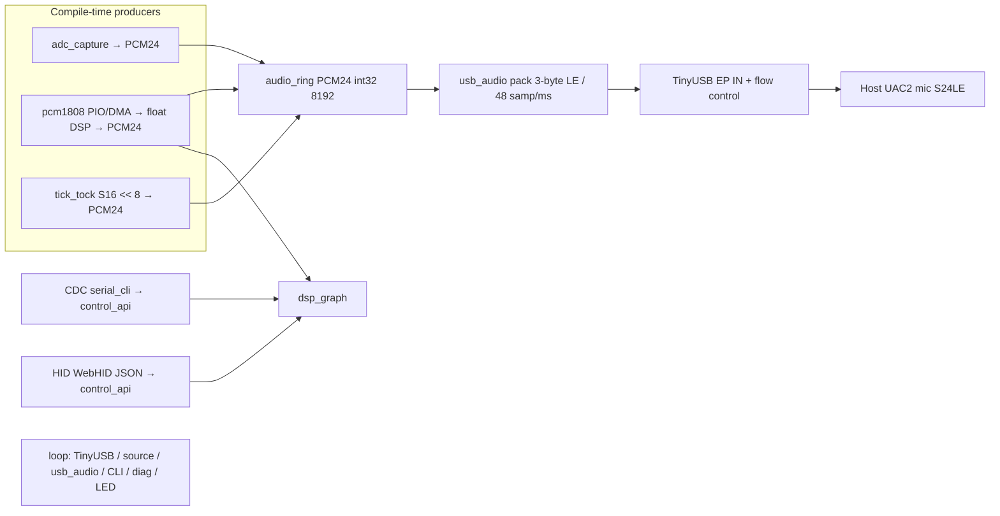

# As-Built Architecture Spec

This document describes the **firmware as implemented**. Use it to align external / parallel spec docs with reality. Where behavior differs from [`IMPLEMENTATION_SPEC.md`](../IMPLEMENTATION_SPEC.md) or older handoff notes, **this file wins** for “what the code does.”

---

## 1. Purpose

USB recording device that appears to a host as a **UAC2 mono microphone** at **48 kHz, signed 24-bit little-endian (3 bytes/sample), 1 channel**, for watch-tick capture and timing DSP evaluation.

Three compile-time audio sources (`-DAUDIO_SOURCE=…`):

| Source | Role |
|---|---|
| **ADC** | RP2350 onboard SAR ADC → DMA → oversample/DC/scale → **PCM24** ring → USB |
| **PCM1808** | External PCM1808 I²S (PIO + DMA) → float DSP graph → **PCM24** ring → USB |
| **SYNTHETIC** | Looped S16 `tick-tock.wav` table, MSB-aligned into PCM24 → USB (host/USB validation) |

**RP2350 / RP2354 only.** RP2040 PlatformIO environments have been removed.

---

## 2. Toolchain and boards

### 2.1 Build system

| Item | As built |
|---|---|
| Build | **PlatformIO** |
| Platform | `https://github.com/maxgerhardt/platform-raspberrypi.git` |
| Framework | **Arduino** (`board_build.core = earlephilhower`) |
| USB stack | Adafruit TinyUSB (`-DUSE_TINYUSB`), `lib_archive = no` |
| DSP lib | Vendored **CMSIS-DSP** (`third_party/CMSIS-DSP`), `ARM_MATH_CM33`, framework softfp ABI |
| Language | C++ application modules + C-style APIs; Arduino `setup()` / `loop()` |
| RTOS | None |
| Second core | Parked at boot (`multicore_reset_core1()`); all work on core 0 today |

**Not used:** pure Pico SDK CMake project without Arduino.

### 2.2 Environments (`platformio.ini`)

| Env | Board ID | Package | Flash | ADC GPIO | `AUDIO_SOURCE` |
|---|---|---|---|---|---|
| `pico2` | `rpipico2` | RP2350A | board default | **26** | ADC |
| `pico2_synthetic` | `rpipico2` | RP2350A | board default | 26 | SYNTHETIC |
| `pico2_pcm1808` | `rpipico2` | RP2350A | board default | 26 | PCM1808 |
| `kiwi` | `generic_rp2350` | RP2350B (`__PICO_RP2350A=0`) | **2 MB** | **40** | ADC |
| `kiwi_synthetic` | `generic_rp2350` | RP2350B | **2 MB** | 40 | SYNTHETIC |
| `kiwi_pcm1808` | `generic_rp2350` | RP2350B | **2 MB** | 40 | PCM1808 |

Kiwi upload/debug: `picoprobe`. Status LED: **GPIO 25** on Pico 2 and Kiwi.

PCM1808 pins: **Pico 2 PCB** MCLK **GP21**, LRCK **GP20**, DOUT **GP19**, BCK **GP18**; **Kiwi / legacy** MCLK **GP21**, BCK **GP2**, LRCK **GP3**, DOUT **GP4**. PIO wait immediates are board-baked (`pcm1808_i2s_pico2` vs `pcm1808_i2s_legacy`). See [`PCM1808_WIRING_AND_CLOCKS.md`](PCM1808_WIRING_AND_CLOCKS.md).

### 2.3 TinyUSB config mechanism

`CFG_TUSB_CONFIG_FILE` is unreliable under PlatformIO (project `include/` is not first for library compiles). Live TinyUSB knobs are **`-DCFG_TUD_*` flags in `platformio.ini`**. [`include/tusb_config.h`](../include/tusb_config.h) is a reference mirror.

Key audio flags: `N_BYTES_PER_SAMPLE_TX=3`, `EP_SZ_IN=147` (49×3), `EP_IN_SW_BUF_SZ=588`, `EP_IN_FLOW_CONTROL=1`.

---

## 3. Source tree

```text
timegrapher-stand/
  platformio.ini
  tick-tock.wav
  IMPLEMENTATION_SPEC.md
  README.md / LICENSES.md
  include/
    app_config.h              # rates, ring, ADC/PCM1808 knobs, PCM24 limits
    board_config.h            # board name, pins, BOOST_SWITCH, PCM1808 pins
    tick_tock_pcm.h           # generated S16 table (SYNTHETIC)
    tusb_config.h             # reference TinyUSB mirror
    audio_ring.h              # PCM24 int32 ring + 3-byte pack helper
    audio_source.h            # stream FSM
    adc_capture.h / pcm1808_*.h / pcm1808_format.h
    usb_audio.h / diagnostics.h / power_control.h
    dsp_types.h / dsp_graph.h / control_api.h / perf_timing.h
    serial_cli.h / cli/*.h
    dsp_cmsis_smoke.h
  src/
    TimegrapherStand_main.cpp # setup/loop: power, USB, CLI, LED
    usb_audio.cpp             # UAC callbacks, 1 ms PCM24 feed
    usb_descriptors.cpp       # Adafruit_USBD_Interface → mic descriptors
    audio_source.cpp          # FSM + ADC / PCM1808 / SYNTHETIC
    audio_ring.cpp
    adc_capture.cpp
    pcm1808_capture.cpp / pcm1808_clock.cpp
    # PIO: scripts/pcm1808_i2s.pio.in → include/pcm1808_i2s_{pico2,legacy}.pio.h
    dsp_graph.cpp / control_api.cpp / perf_timing.cpp / dsp_cmsis_smoke.cpp
    serial_cli.cpp / cli/cli_core.cpp / cli/cli_commands.cpp
    diagnostics.cpp / power_control.cpp
  third_party/CMSIS-DSP/      # vendored CMSIS-DSP sources
  scripts/
    gen_tick_tock_pcm.py
  docs/
    AS_BUILT_ARCHITECTURE.md  # this file
    HID_CONTROL_PLANE.md      # WebHID/JSON control spec (H0; firmware H1+)
    hid/timegrapher_hid.d.ts  # TypeScript contracts
    hid/webhid_example.md     # browser sketch
    PCM1808_WIRING_AND_CLOCKS.md
    build_and_flash.md
    PORTING_TO_PCM1809.md
    acceptance_results.md
    Watch_Timing_RP2350_RP2354_DSP_Handoff.md  # design intent (may lag code)
  tests/
    host_analyze.py           # S16 or S24 WAV stats
    host_capture.md
    test_pcm_conversion.c     # ADC → PCM24 mirror
    test_pcm1808_pcm_conversion.c
    test_ring_buffer.c
```

---

## 4. Runtime architecture



### 4.1 Main loop ([`TimegrapherStand_main.cpp`](../src/TimegrapherStand_main.cpp))

1. `TinyUSBDevice.task()`
2. `audio_source_process()` — deferred capture start/stop, producer → ring, prefill→active
3. `usb_audio_task()` — once per `millis()`, write **48 PCM24 samples** (144 bytes) into TinyUSB
4. `serial_cli_tick()` — watchdog poll, async DSP errors, CDC line CLI
5. `diagnostics_poll()` — ~2 s CDC/UART status line when enabled
6. Status LED blink (rate depends on mount/stream; off while suspended)

Init in `setup()`: `multicore_reset_core1()` → `power_control_init()` → diagnostics → `audio_source_init()` → `usb_audio_init()` → `serial_cli_init()`.

### 4.2 Stream state machine ([`audio_source`](../src/audio_source.cpp))

| State | Meaning |
|---|---|
| `USB_UNCONFIGURED` | Not mounted / disconnected |
| `USB_CONFIGURED_IDLE` | Enumerated; AS alt 0 (not recording) |
| `STREAM_PREFILL` | AS alt ≠ 0; filling ring toward `APP_RING_PREFILL_SAMPLES` (960 ≈ 20 ms) |
| `STREAM_ACTIVE` | Prefill met; USB feeder drains live audio |
| `USB_SUSPENDED` | Bus suspend; capture requested off, boost aborted |
| `STREAM_ERROR` | Backend init failed (e.g. PCM1808 MCLK / clk_sys check) |

Capture hardware start/stop is **deferred to the main loop** (never from TinyUSB control callbacks) so DMA abort cannot hang the USB stack.

Optional **preamp warm-up** (`power_control`, `PREAMP_SETTLE_MS`) runs before prefill when `BOOST_SWITCH_PRESENT=1`. Default builds leave the switch **unassigned** (`BOOST_SWITCH_PRESENT=0`) — warm-up is a no-op and capture starts immediately.

Suspend/resume: suspend aborts boost and drops capture; resume re-arms recording if the stream was still armed.

---

## 5. USB audio (as built)

### 5.1 Device identity

| Field | Value |
|---|---|
| VID / PID | `0xCafe` / `0x4003` |
| Manufacturer | `TimegrapherStand` |
| Product | `Watch Timing Microphone (Prototype)` |
| Audio interface string | `Watchgrapher Studio Interface` |

### 5.2 Class / format

| Parameter | Value |
|---|---|
| Class | UAC2 |
| Direction | Recording only (EP IN); no EP OUT / feedback |
| Channels | 1 |
| Format | **PCM S24LE** (3 bytes/sample on the wire) |
| Rate | 48000 Hz only |
| `wMaxPacketSize` | **147** bytes (49 × 3) |
| Descriptor | `TUD_AUDIO_MIC_ONE_CH_DESCRIPTOR` with bytes/sample = 3, bit res = 24 |

Feature unit: mute + volume present for host compliance. **Mute zeros USB output; volume is not applied to PCM** (advertised 0…0 dB).

### 5.3 Composite with CDC

Adafruit TinyUSB Arduino requires CDC to link and always adds USB Serial.

**As built:** device enumerates as **CDC + UAC2 mic**. CDC carries the diagnostic stream and the interactive DSP CLI.

### 5.4 Stream open / close

- Open: `tud_audio_set_itf_cb` — low byte of `wValue` is alt setting; alt ≠ 0 starts streaming / arms source.
- Close: `tud_audio_set_itf_close_ep_cb` stops streaming and resets source.

While alt ≠ 0 but the FSM is still in PREFILL (or not ACTIVE), the feeder sends **digital silence** so ISO keeps running without draining an empty ring.

### 5.5 PCM feed to TinyUSB

- Application writes **exactly 48 mono PCM24 samples once per millisecond**, packed to 3-byte LE (`audio_pcm24_pack_le`).
- `CFG_TUD_AUDIO_EP_IN_FLOW_CONTROL=1` — TinyUSB chooses on-wire 47/48/49 sample sizes.
- Do **not** burst multiple frames into the FIFO (historical pitch/warp distortion).
- Ring underrun while ACTIVE: **hold last sample** (not zeros).
- Optional catch-up: if `loop()` stalls, feed at most a few missed 1 ms frames.

---

## 6. PCM ring buffer

| Parameter | Value |
|---|---|
| Capacity | 8192 samples (power of two) ≈ **171 ms** @ 48 kHz |
| Element | `audio_sample_t` = `int32_t` holding **signed PCM24** |
| Prefill target | 960 samples (~20 ms) |
| Model | Free-running indices; leave one slot empty |
| Producer | ADC convert, PCM1808+DSP, or synthetic |
| Consumer | `usb_audio` (48 samples / ms) |
| Overrun / underrun | Counted in diagnostics |

Wire packing (int32 → 3 LE bytes) happens only in the USB feeder, not in the ring.

---

## 7. Audio sources

### 7.1 SYNTHETIC

| Item | As built |
|---|---|
| Asset | `tick-tock.wav` — mono S16LE @ 48 kHz, 19192 frames (~400 ms) |
| Embed | [`tick_tock_pcm.h`](../include/tick_tock_pcm.h) via `scripts/gen_tick_tock_pcm.py` |
| To ring | Exact S16 sample **left-shifted 8 bits** into PCM24 container |
| Playback | Index 0…LEN-1, wrap; keep ring ≈ prefill + 10 ms ahead |

### 7.2 ADC

| Item | As built |
|---|---|
| API | Pico SDK `hardware_adc` + `hardware_dma` |
| Pins | Pico2: GPIO26 / ch0; Kiwi: GPIO40 / ch0 |
| Rate | Raw capture at `48 kHz × ADC_OVERSAMPLE` (default oversample **8**) |
| DMA | Ping-pong, 2 × (`240 × oversample`) raw samples; IRQ marks ready |
| DC | Learn midrail from first raw block when `ADC_DC_REMOVE=1` |
| Scale | `(centered * ADC_PCM_SCALE) << 8` → clamp to PCM24 (`ADC_PCM_SCALE` default **48**) |
| Optional LPF | `ADC_LPF_SHIFT` (default 0 = off) |
| DSP graph | **Not used** on this path today — PCM24 goes straight to the ring |

### 7.3 PCM1808

| Item | As built |
|---|---|
| Mode | Codec master I²S; MCU generates **MCLK ~12.288 MHz** on GP21 (`clock_gpio_init_int_frac16`, assumes **150 MHz** `clk_sys`). Pico 2 I²S: BCK GP18 / DOUT GP19 / LRCK GP20 |
| Capture | PIO RX SM + single DMA channel ping-pong (IRQ swaps buffers) |
| Block | 240 stereo frames (480 `uint32` slot words) per DMA buffer |
| Mono | Left slot only: arithmetic `>> 8` → sign-extended 24-bit |
| DSP | Always through `dsp_graph_process` (float FS → PCM24) |
| Upsample | `PCM1808_OUTPUT_UPSAMPLE` default **2** (bench fix when LRCK ≈ 24 kHz); set to 1 if LRCK is truly 48 kHz |
| Format helper | `pcm1808_left_slot_to_pcm24()` in `pcm1808_format.h` (host-tested); live path uses DSP unpack |

Boot checks `clk_sys == 150e6` and `clk_usb == 48e6`. MCLK starts in `audio_source_init()` so GP21 runs without opening a USB stream. Capture may defer until MCLK warmup / ready.

---

## 8. DSP graph (PCM1808 path)

Implemented in [`dsp_graph.cpp`](../src/dsp_graph.cpp) / [`dsp_types.h`](../include/dsp_types.h). Host control goes through [`control_api`](../include/control_api.h) (CDC CLI now; HID-ready later).

### 8.1 Pipeline order

```text
PCM1808 left24 → float FS (/8388608)
  → analysis (meters, noise, match, event, beat, spectrum)  [never mutates PCM]
  → process  (notch → IIR filter → FIR → soft_gate → gain → AGC → limiter)
                                                            [only if bypass off]
  → quantize to signed PCM24 (int32)
  → optional PCM1808_OUTPUT_UPSAMPLE repeat
  → audio_ring
```

Master **bypass** defaults **on**: process path is identity; analysis may still run. When bypass is on, optional `PCM1808_PCM_GAIN` is applied at quantize. When bypass is off, loudness is the **gain** / **AGC** blocks.

CMSIS-DSP kernels: `arm_power_f32`, `arm_biquad_cascade_df1_*`, `arm_fir_f32`, `arm_dot_prod_f32`, `arm_rfft_fast_f32` (512).

### 8.2 Blocks

| Block | Path | Default | Behavior |
|---|---|---|---|
| `bypass` | Master gate | on | Process path skipped when on |
| `level_meter` | Analysis | on | Pre peak / RMS EMA |
| `noise_floor` | Analysis | on | EMA of RMS on quiet blocks (feeds detect / gate) |
| `event_detect` | Analysis | on | Threshold × noise; hysteresis; max 80 ms; min-peak gate |
| `beat_rate` | Analysis | on | Unlock intervals → vph, daily rate s/d, beat error ms, amplitude ° |
| `event_log` | Analysis store | (ring) | Last `DSP_EVENT_LOG_CAP` (32) events (rise/snr/energy) |
| `notch` | Process | off | Narrow RBJ notch at 50 or 60 Hz |
| `filter_bank` | Process | off | Cascaded one-pole HPF+LPF presets (wide/medium/narrow) |
| `soft_gate` | Process | off | Fast open on impulses; release toward `floor_db` between ticks |
| `gain` | Process | off | Fixed make-up gain from `db` param |
| `agc` | Process | off | Slow peak follower toward `target` FS (τ seconds; ±12 dB) |
| `limiter` | Process | on | Hard clamp at ±1.0 FS before PCM24 quantize |
| `matched_filter` | Analysis | off | 64-sample learned template + correlation gate for event opens |
| `fir_bank` | Process | off | 64-tap Hamming FIR bandpass (same presets as filter_bank) |
| `spectrum` | Analysis | off | 512-point RFFT; top-8 tonal peaks (`dsp spectrum`) |

Enabling process blocks (**notch / filter / fir / soft_gate / gain / agc / limiter**) **clears master bypass** and arms the USB continuity watchdog.

CLI: `dsp help <block>` prints a short description and params; aliases include `on`/`off`, `gate`, `filter`, `event`, `dsp set gain 12`, `dsp set notch 60`.

### 8.3 Event detect / beat rate (algorithms)

- **Noise EMA:** adapts on quiet blocks only (peak below open threshold).
- **Open event:** `|x| > max(noise×threshold, 4×pre_rms, 1e-3)` (default threshold **6**). Window start = onset − `preroll_ms` (default 25 ms).
- **Close event:** hysteresis (`0.35×` open thr) for `tail_ms`, or max duration **80 ms**. Reject peaks below `max(open_thr, 0.25×tick_peak_ema)`. Log rise, snr_db, energy, confidence.
- **Beat rate:** Keep up to 16 unlock-to-unlock half-intervals (~25 ms … 1 s at analysis rate). With ≥4 samples, median → `vph_raw = 3600 / period_s`. Lock if within **4%** of nominal A/h (auto common table `{14400…57600}` or manual `vph` param). When locked: TIC/TAC full-period average → instant `rateSDay`; `|T1−T2|/2` → instant `beatErrorMs`; unlock→drop lift time + `liftAngle` (default 51°) → instant `amplitudeDeg` via `A = λ / (2 sin(π f t))`. Instant values are also averaged into rolling **`avg1s`** (~1 s) and **`avg10s`** (~10 s) windows (arithmetic mean, ≥2 samples per metric).

### 8.4 Continuity watchdog / auto-eject

`dsp_graph_watchdog_poll()` (from CLI tick):

- After a process block is enabled, snapshot ring-underrun and USB short-write counters.
- For ~5 s, if underruns rise or short-writes jump by >50, **disable that block**, log a fault, queue `CLI: ERR dsp eject …`, and cool down ~2 s.

### 8.5 What is *not* in the DSP path yet

- Phase 4 STFT spectral denoising (deferred)
- Multicore offload (core 1 parked)
- ADC / SYNTHETIC producers calling `dsp_graph_process`

---

## 9. CDC CLI and control plane

| Layer | Role |
|---|---|
| `serial_cli` | Main-loop glue: watchdog, async errors, `Cli::coreTick` |
| `cli_core` | Line editor, tokenize, dispatch (no history) |
| `cli_commands` | `help`, `version`/`ver`, `status`, `diag`, `dsp …` |
| `control_api` | Transport-agnostic façade over `dsp_graph` (CDC + HID) |
| `hid_control` | Vendor HID JSON framer / RPC (WebHID) |
| `perf_timing` | DSP block + main-loop µs timing / busy% (headroom) |

Useful `dsp` subcommands: `list`, `status`/`bypass`, `on`/`off`/`enable`/`disable`, `get`/`set`, `events`, `beat`/`rate`, `metrics`, `timing`/`cpu` [`reset`], `errors` [`clear`], `help` [`block`].

Formatting stays in the CLI; `control_api` returns structured data only.

### 9.1 HID / WebHID control plane (spec)

Browser control is designed for **WebHID**, not CDC text. Normative docs:

| Artifact | Role |
|---|---|
| [`HID_CONTROL_PLANE.md`](HID_CONTROL_PLANE.md) | Framing, JSON ops, `getState`/`patchState`/`subscribe` |
| [`hid/timegrapher_hid.d.ts`](hid/timegrapher_hid.d.ts) | TypeScript contracts for web apps |
| [`hid/webhid_example.md`](hid/webhid_example.md) | Connect / framer / request sketch |

Locked model:

- Composite USB keeps UAC2 + CDC; HID is an added vendor interface (Usage Page `0xFFA0`, Usage `0x0001`).
- JSON UTF-8 over fragmented Input/Output reports (report ID `0x01`); no Feature-report RPC; no audio on HID.
- JS-facing ops: `hello`, `getState`, `patchState`, `subscribe`, plus one-shot metrics/timing/beat/events/errors.
- Firmware HID codec (when implemented) calls **`control_api` only**, same as the CLI.

Firmware: `CFG_TUD_HID=1`, Usage Page `0xFFA0` / Usage `0x0001` / Report ID `0x01`. Smoke UI: [`hid/example.html`](hid/example.html) (localhost/HTTPS + user gesture).

---

## 10. Power control (Stage-1)

[`power_control`](../include/power_control.h): TPS22918 **BOOST_EN** for an 8 V preamp rail when wired.

| Item | As built |
|---|---|
| Default | `BOOST_SWITCH_PRESENT=0` — GPIO unassigned; logical API still tracks state |
| Polarity | Active HIGH; init forces OFF |
| Warm-up | Nonblocking `PREAMP_SETTLE_MS` (default 50) before capture prefill when switch present |
| Scope | Stage-1 suspend-aware enable/disable only — **no** MCU deep sleep / USB current compliance claims |

---

## 11. Diagnostics and LED

### 11.1 Counters ([`diagnostics`](../src/diagnostics.cpp))

USB enum/open/close/suspend/resume; boost/preamp settle; ADC window stats; DMA/ring/USB packet stats; PCM1808 clock/DMA/stall/saturation peaks. See `diag_counters_t`.

CPU headroom lives in [`perf_timing`](../include/perf_timing.h) / `dsp_timing_t`: wall time of each `dsp_graph_process` vs block budget, plus main-loop busy% over 1 s. Exposed via `dsp timing`, HID `getTiming` / `subscribe.timingHz`, and appended on the periodic diag line (`dsp_us=last/mean/max bud=… busy=…%`).

Periodic print ~every **2 s** when `DIAG_CDC=1` (default) and/or `DIAG_UART=1`. Windowed ADC/ring extrema and timing maxima clear after each line.

### 11.2 Status LED (GPIO 25)

| Condition | Blink period |
|---|---|
| Not mounted | ~1000 ms |
| Mounted, idle | ~500 ms |
| Streaming | ~100 ms |
| USB suspended | LED forced off |
| `usb_audio_init` failure | 50 ms hard-fault blink |

---

## 12. Constants cheat sheet (`app_config.h`)

| Symbol | Default |
|---|---|
| `APP_SAMPLE_RATE_HZ` | 48000 |
| `APP_BYTES_PER_SAMPLE` | **3** |
| `APP_PCM24_FULL_SCALE` / `MIN` | 8388607 / −8388608 |
| `APP_RING_CAPACITY` | 8192 |
| `APP_RING_PREFILL_SAMPLES` | **960** (~20 ms) |
| `APP_ADC_DMA_BUF_SAMPLES` | 240 |
| `ADC_OVERSAMPLE` | 8 |
| `ADC_PCM_SCALE` | 48 (then `<< 8` into PCM24) |
| `APP_PCM1808_DMA_FRAMES` | 240 |
| `PCM1808_OUTPUT_UPSAMPLE` | 2 |
| `PCM1808_PCM_GAIN` | 1 |
| `APP_PKT_SAMPLES_NOM` | 48 |
| `DSP_MAX_BLOCK` | 240 |
| `PREAMP_SETTLE_MS` | 50 |

`AUDIO_SOURCE`: `SYNTHETIC=1`, `ADC=2`, `PCM1808=3`.

---

## 13. Divergences from older specs / docs

| Older intent | As built |
|---|---|
| PCM **S16LE** USB mic | PCM **S24LE** (3 bytes), EP max 147 |
| Ring of `int16_t` | Ring of PCM24 in `int32_t` |
| Prefill 480 (~10 ms) | Prefill **960 (~20 ms)** |
| ADC/synth only | **PCM1808** PIO+DMA path + float DSP |
| No DSP / CLI | Float32 graph + CMSIS-DSP + CDC CLI + `control_api` |
| App owns 47/48/49 sizing | App feeds **48/ms**; TinyUSB flow control sizes ISO |
| No USB CDC | **CDC required** (Adafruit) — also used for CLI/diag |
| CMake / no Arduino | PlatformIO + Arduino-Pico |
| RP2040 envs | **Removed** (RP2350-only matrix) |
| PCM1808 24→16 truncate | **No** 16-bit truncate; float hop only inside DSP |
| Audio-only function set | Composite **CDC + UAC2 mic + vendor HID** ([`HID_CONTROL_PLANE.md`](HID_CONTROL_PLANE.md)) |

Functional goals that **are** implemented: UAC2 mono 48 kHz S24 mic, DMA ADC path, PCM1808 capture, PCM24 ring, stream FSM with suspend/power hooks, DSP Phase-1 analysis/process + watchdog, six RP2350 envs, host conversion tests, host analyze script (16- or 24-bit WAV).

---

## 14. Host-facing behavior

- Host sees a recording device (interface string `Watchgrapher Studio Interface`) plus a USB serial port.
- Record: mono **S24_LE** 48 kHz (hosts that only offer S16 may downsample — prefer a 24-bit capable path).
- Synthetic: repeating ~400 ms tick-tock, MSB-aligned into 24-bit.
- CDC: type `help` / `dsp help` for the control plane; `status` for mount/stream/bypass.
- LED: ~1 Hz when idle mounted; fast blink when capturing; off on suspend.

Hardware soak / codec quality acceptance remain per [`acceptance_results.md`](acceptance_results.md).

---

## 15. Extension points

| Goal | Touch points |
|---|---|
| New board | New PlatformIO env; ADC/PCM1808 pins; package macros; LED |
| New synthetic asset | Replace `tick-tock.wav` → `python3 scripts/gen_tick_tock_pcm.py` |
| True 48 kHz LRCK on PCM1808 | Confirm straps/MCLK; set `-DPCM1808_OUTPUT_UPSAMPLE=1` |
| Wire BOOST_EN | `-DBOOST_SWITCH_PRESENT=1 -DBOOST_EN_GPIO=N` |
| Run ADC through DSP | Call `dsp_graph_process` from `adc_capture` like PCM1808 |
| Core 1 offload | Prefer heavy DSP/analysis first; marshal CDC/`Serial` if CLI moves |
| PCM1809 | See [`PORTING_TO_PCM1809.md`](PORTING_TO_PCM1809.md); keep USB/ring/feed contracts |
| HID / WebHID control | Follow [`HID_CONTROL_PLANE.md`](HID_CONTROL_PLANE.md); `hid_control` → `control_api`; keep CDC CLI |

---

## 16. File ↔ responsibility map

| Module | Responsibility |
|---|---|
| `TimegrapherStand_main.cpp` | Arduino entry, core1 park, init order, LED |
| `power_control.cpp` | Boost enable + nonblocking preamp settle |
| `usb_descriptors.cpp` | UAC2 mic descriptor injection (24-bit) |
| `usb_audio.cpp` | Device IDs/strings, UAC controls, 1 ms PCM24 feed |
| `audio_source.cpp` | Stream FSM, source select, warm-up gate |
| `audio_ring.cpp` | PCM24 ring |
| `adc_capture.cpp` | ADC+DMA+PCM24 convert (ADC builds) |
| `pcm1808_clock.cpp` | GPOUT0 MCLK bring-up / rate checks |
| `pcm1808_capture.cpp` | PIO+DMA → DSP → ring (PCM1808 builds) |
| `dsp_graph.cpp` | Float analysis/process, PCM24 quantize, watchdog |
| `control_api.cpp` | Transport-agnostic DSP façade |
| `hid_control.cpp` | WebHID JSON control (vendor HID) |
| `serial_cli.cpp` / `cli/*` | CDC CLI |
| `diagnostics.cpp` | Counters / CDC|UART dump |
| `tick_tock_pcm.h` | Synthetic S16 payload |

---

*End of as-built architecture. Prefer this document over IMPLEMENTATION_SPEC.md and older handoff markdown when documenting current firmware behavior.*
