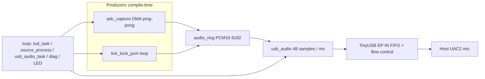

# As-Built Architecture Spec

This document describes the **firmware as implemented**. Use it to align external / parallel spec docs with reality. Where behavior differs from [`IMPLEMENTATION_SPEC.md`](../IMPLEMENTATION_SPEC.md), this file wins for “what the code does.”

---

## 1. Purpose

USB recording device that appears to a host as a **UAC2 mono microphone** at **48 kHz, signed 16-bit little-endian, 1 channel**, for watch-tick capture evaluation.

Two compile-time audio sources:

| Source | Role |
|---|---|
| **ADC** | RP2350 onboard ADC → DMA → PCM16 → USB |
| **SYNTHETIC** | Looping PCM table from `tick-tock.wav` → USB (USB/host validation) |

Future I²S (PCM1809) is not implemented; the source boundary is designed so USB/ring stay unchanged.

---

## 2. Toolchain and boards

### 2.1 Build system

| Item | As built |
|---|---|
| Build | **PlatformIO** |
| Platform | `https://github.com/maxgerhardt/platform-raspberrypi.git` |
| Framework | **Arduino** (`board_build.core = earlephilhower`) |
| USB stack | Adafruit TinyUSB (`-DUSE_TINYUSB`), `lib_archive = no` |
| Language | C++ application modules + C-style APIs; Arduino `setup()` / `loop()` |
| RTOS | None |

**Not used:** pure Pico SDK CMake project, no Arduino (that was the original P1.0 preference).

### 2.2 Environments (`platformio.ini`)

| Env | Board ID | Package | Flash | ADC GPIO | `AUDIO_SOURCE` |
|---|---|---|---|---|---|
| `pico2` | `rpipico2` | RP2350A | board default | **26** | ADC |
| `pico2_synthetic` | `rpipico2` | RP2350A | board default | 26 | SYNTHETIC |
| `kiwi` | `generic_rp2350` | RP2350B (`__PICO_RP2350A=0`) | **2 MB** | **40** | ADC |
| `kiwi_synthetic` | `generic_rp2350` | RP2350B | **2 MB** | 40 | SYNTHETIC |

Kiwi upload/debug: `picoprobe`. Board difference for audio today is **ADC pin (+ package macro / flash)** only.

Status LED: **GPIO 25** on both Pico 2 and Kiwi.

### 2.3 TinyUSB config mechanism

`CFG_TUSB_CONFIG_FILE` was unreliable under PlatformIO (project `include/` is not first for library compiles). Live TinyUSB knobs are **`-DCFG_TUD_*` flags in `platformio.ini`**. [`include/tusb_config.h`](../include/tusb_config.h) is a reference mirror only.

---

## 3. Source tree

```text
timegrapher-stand/
  platformio.ini
  tick-tock.wav                 # source asset for synthetic PCM
  IMPLEMENTATION_SPEC.md        # original requirements (P1.0)
  README.md / LICENSES.md
  include/
    app_config.h                # rates, ring, ADC scale, packet constants
    board_config.h              # ADC_GPIO/CHANNEL, LED, board name
    tick_tock_pcm.h             # generated PCM table (SYNTHETIC)
    tusb_config.h               # reference TinyUSB config (not primary)
    audio_ring.h / audio_source.h / adc_capture.h
    usb_audio.h / diagnostics.h
  src/
    TimegrapherStand_main.cpp   # setup/loop, LED heartbeat
    usb_audio.cpp               # UAC callbacks, 1 ms PCM feed
    usb_descriptors.cpp         # Adafruit_USBD_Interface → mic descriptors
    audio_source.cpp            # stream FSM + ADC/SYNTHETIC producer
    audio_ring.cpp              # PCM16 ring buffer
    adc_capture.cpp             # ADC FIFO + DMA ping-pong (ADC builds)
    diagnostics.cpp             # counters; optional UART dump
  scripts/
    gen_tick_tock_pcm.py        # regenerates tick_tock_pcm.h from WAV
  docs/
    AS_BUILT_ARCHITECTURE.md    # this file
    build_and_flash.md
    PORTING_TO_PCM1809.md
    acceptance_results.md
  tests/
    host_analyze.py
    host_capture.md
    test_pcm_conversion.c / test_ring_buffer.c   # host-side unit tests
```

---

## 4. Runtime architecture



### 4.1 Main loop ([`TimegrapherStand_main.cpp`](../src/TimegrapherStand_main.cpp))

1. `TinyUSBDevice.task()`
2. `audio_source_process()` — fill ring from ADC DMA completions or synthetic table
3. `usb_audio_task()` — once per `millis()`, write **48 samples** into TinyUSB
4. `diagnostics_poll()` — no-op unless `DIAG_UART=1`
5. Status LED blink (rate depends on mount/stream)

Init order in `setup()`: diagnostics → audio_source → `usb_audio_init()` (add mic interface, set strings/VID/PID, re-attach if already mounted).

### 4.2 Stream state machine ([`audio_source`](../src/audio_source.cpp))

| State | Meaning |
|---|---|
| `USB_UNCONFIGURED` | Not mounted / disconnected |
| `USB_CONFIGURED_IDLE` | Enumerated; AS alt 0 (not recording) |
| `STREAM_PREFILL` | AS alt ≠ 0; filling ring toward ~480 samples |
| `STREAM_ACTIVE` | Prefill met; normal streaming |
| `USB_SUSPENDED` | USB suspend |
| `STREAM_ERROR` | Defined; not heavily used yet |

Transitions:

- Mount → configured idle  
- `SET_INTERFACE` alt ≠ 0 → open → prefill → active  
- Close EP / unmount / suspend → stop capture, reset ring  

---

## 5. USB audio (as built)

### 5.1 Device identity

| Field | Value |
|---|---|
| VID / PID | `0xCafe` / `0x4003` (bench TinyUSB-style IDs) |
| Manufacturer | `TimegrapherStand` |
| Product | `Watch Timing Microphone (Prototype)` |
| Audio interface string | `UAC2` (often what hosts show as the input name) |

### 5.2 Class / format

| Parameter | Value |
|---|---|
| Class | UAC2 |
| Direction | Recording only (EP IN); no speaker / EP OUT / feedback EP |
| Channels | 1 |
| Format | PCM S16LE |
| Rate | 48000 Hz only |
| `wMaxPacketSize` budget | 98 bytes (49 samples) |
| Descriptor template | `TUD_AUDIO_MIC_ONE_CH_DESCRIPTOR` |

Feature unit: mute + volume **controls are implemented for host compliance**. Mute zeros USB output; **volume is not applied to PCM** (range advertised as 0…0 dB).

### 5.3 Composite with CDC (important divergence)

Adafruit TinyUSB Arduino **requires `CFG_TUD_CDC≥1` to link** and always adds USB Serial in `TinyUSBDevice.begin()`.

**As built:** device enumerates as **CDC + UAC2 mic** (composite). Spec’s “audio-only, no CDC” is **not** met.

Descriptors: mic is added via custom `Adafruit_USBD_Interface` subclass after core init ([`usb_descriptors.cpp`](../src/usb_descriptors.cpp)).

### 5.4 Stream open / close

- Open: `tud_audio_set_itf_cb` — **`wValue` low byte** is alternate setting (`tu_u16_low`). Alt ≠ 0 starts streaming.
- Close: `tud_audio_set_itf_close_ep_cb` stops streaming and resets source.

### 5.5 PCM feed to TinyUSB

**As built pacing (critical):**

- Application writes **exactly 48 mono samples once per millisecond** (`usb_audio_feed_frame`), matching TinyUSB `audio_test` style.
- `CFG_TUD_AUDIO_EP_IN_FLOW_CONTROL=1` — TinyUSB chooses on-wire 47/48/49 sample packet sizes from FIFO level.
- Do **not** burst multiple frames into the FIFO; that previously caused near-constant 49-sample packets and audible pitch/warp distortion.
- Ring underrun: **hold last sample** (not digital silence zeros).
- Optional catch-up: if `loop()` stalls, feed at most 5 missed 1 ms frames.

Ring occupancy-based 47/48/49 helpers still exist in [`audio_ring`](../src/audio_ring.cpp) / `app_config.h` but are **not** what sizes USB packets today; TinyUSB flow control owns that.

---

## 6. PCM ring buffer

| Parameter | Value |
|---|---|
| Capacity | 8192 samples (power of two) |
| Element | `int16_t` PCM |
| Prefill target | 480 samples (~10 ms) |
| Model | Free-running read/write indices; leave one slot empty |
| Producer | `audio_source` (ADC convert path or synthetic) |
| Consumer | `usb_audio` (48 samples / ms) |
| Overrun / underrun | Counted in diagnostics |

---

## 7. Audio sources

### 7.1 SYNTHETIC

| Item | As built |
|---|---|
| Asset | `tick-tock.wav` — mono, S16LE, **48000 Hz**, 19192 frames (~400 ms) |
| Embed | [`include/tick_tock_pcm.h`](../include/tick_tock_pcm.h) via `scripts/gen_tick_tock_pcm.py` |
| Processing | **Exact sample copy** — **no crossfade, no rotation** |
| Playback | Index 0…LEN-1, wrap to 0 |
| Prefill policy | Keep ring ≈ prefill + 10 ms ahead while streaming |

Original P1.0 synthetic 997 Hz sine is **replaced** by this looped WAV.

### 7.2 ADC

| Item | As built |
|---|---|
| API | Pico SDK `hardware_adc` + `hardware_dma` |
| Channel | Single; round-robin off |
| Pins | Pico2: GPIO26 / ch0; Kiwi: GPIO40 / ch0 |
| Clock | `adc_set_clkdiv(adc_hz/48000 - 1)` after reading `clk_adc` |
| FIFO | DMA DREQ, ERR flag in bit 15, **no** 8-bit shift |
| DMA | Ping-pong, 2 × 240 samples (5 ms), chained, IRQ0 marks ready |
| ISR work | Mark buffer ready / counters only |
| Convert (main) | `code = word & 0xFFF`; `(code - ADC_DC_OFFSET) * 16` → clamp `int16_t` |
| Default offset | `ADC_DC_OFFSET_COUNTS = 2048` |
| Error samples | Bit15 set → hold last valid code; increment error counter |
| DSP | None (no AGC, filters, gain) |

Analog conditioning (AC couple / bias / clamp) is **hardware responsibility**; firmware assumes mid-rail bias near 2048.

---

## 8. Diagnostics and LED

### 8.1 Counters ([`diagnostics`](../src/diagnostics.cpp))

Includes USB enum/open/close/suspend, ADC/DMA/ring/USB packet stats, ADC min/max/mean accumulators. See `diag_counters_t`.

UART print every 5 s only if `-DDIAG_UART=1` (Serial1; default TX/RX GPIO 0/1).

### 8.2 Status LED (GPIO 25)

| Condition | Blink period |
|---|---|
| Not mounted | ~1000 ms |
| Mounted, idle | ~500 ms (~1 Hz half-period toggle) |
| Streaming (`g_streaming`) | ~100 ms |
| `usb_audio_init` failure | 50 ms hard fault blink |

---

## 9. Constants cheat sheet (`app_config.h`)

| Symbol | Value |
|---|---|
| `APP_SAMPLE_RATE_HZ` | 48000 |
| `APP_RING_CAPACITY` | 8192 |
| `APP_RING_PREFILL_SAMPLES` | 480 |
| `APP_ADC_DMA_BUF_SAMPLES` | 240 |
| `APP_ADC_DMA_BUF_COUNT` | 2 |
| `ADC_PCM_SCALE` | 16 |
| `APP_PKT_SAMPLES_NOM` | 48 |

`AUDIO_SOURCE` build flag uses identifiers `ADC` / `SYNTHETIC` mapped to `2` / `1` in `app_config.h`.

---

## 10. Divergences from IMPLEMENTATION_SPEC.md (P1.0)

| P1.0 intent | As built |
|---|---|
| CMake + Pico SDK, no Arduino | PlatformIO + Arduino-Pico |
| No USB CDC | **CDC present** (Adafruit TinyUSB Arduino requirement) |
| Project name `watchtiming-rp2350-adc/` | `timegrapher-stand/` |
| Synthetic = 997 Hz sine | Synthetic = **looped `tick-tock.wav`** (no crossfade) |
| App owns 47/48/49 sizing | App feeds **48/ms**; **TinyUSB flow control** sizes ISO packets |
| Audio-only USB function set | Composite **CDC + UAC2 mic** |
| `tusb_config.h` as build config | Primary config via **`platformio.ini` `-D` flags** |

Functional goals that **are** implemented: UAC2 mono 48 kHz S16 mic, DMA ADC path, ring buffer, stream FSM, board envs for Pico2 vs Kiwi, host analysis script, PCM1809 porting notes.

---

## 11. Host-facing behavior (observed / expected)

- Host sees a recording device (product / interface string may appear as prototype name or `UAC2`).
- Also sees a USB serial (CDC) port.
- Record: mono S16LE 48 kHz (e.g. `arecord -c 1 -f S16_LE -r 48000`).
- Synthetic: repeating ~400 ms tick-tock pattern from the WAV.
- LED: ~1 Hz when idle mounted; fast blink when host opens the capture stream.

Hardware soak / ADC quality acceptance remain per `docs/acceptance_results.md` (many items still unmarked without formal lab results).

---

## 12. Extension points (for spec alignment)

| Goal | Touch points |
|---|---|
| New board | New PlatformIO env; `ADC_GPIO` / `ADC_CHANNEL` / package macros; LED if needed |
| New synthetic asset | Replace `tick-tock.wav` → `python3 scripts/gen_tick_tock_pcm.py` |
| PCM1809 I²S | New producer module; `AUDIO_SOURCE` branch in `audio_source.cpp`; leave USB/descriptors/ring feed unchanged — see `docs/PORTING_TO_PCM1809.md` |
| Remove CDC | Requires leaving Adafruit Arduino USB wrapper or different USB bring-up; not done |

---

## 13. File ↔ responsibility map

| Module | Responsibility |
|---|---|
| `TimegrapherStand_main.cpp` | Arduino entry, init order, LED |
| `usb_descriptors.cpp` | UAC2 mic config descriptor injection |
| `usb_audio.cpp` | Device strings/IDs, UAC control callbacks, 1 ms feed |
| `audio_source.cpp` | Stream FSM, source select, prefill |
| `audio_ring.cpp` | PCM ring |
| `adc_capture.cpp` | ADC+DMA+convert (ADC builds only) |
| `diagnostics.cpp` | Counters / optional UART |
| `tick_tock_pcm.h` | Synthetic PCM payload |

---

*End of as-built architecture. Prefer this document over IMPLEMENTATION_SPEC.md when documenting current firmware behavior.*
