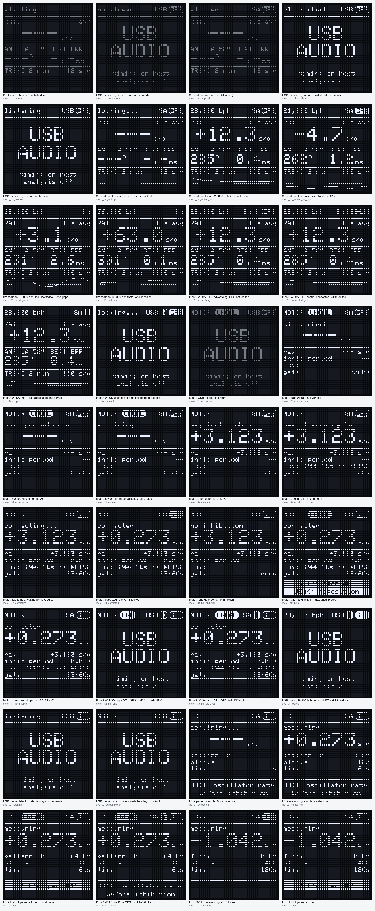

# OLED display

A 128×128 **SH1107** I²C OLED module shows the timing readout. It is driven entirely from **core 1**. Core 0 keeps everything time-critical (TinyUSB, capture, DSP, CLI, HID). A 2 KB frame takes about 55 ms to send at 400 kHz, which would wreck the ~4 ms USB audio slack on core 0. On core 1 it cannot affect the stream.

## Screen gallery



Every header status, the Bluetooth and GPS badge combinations, the mechanical readout with its trend, the USB Audio section, and each quartz status are in `docs/images/oled/`, one PNG per state. They are rendered from the real `src/display_ui.cpp` and the pinned Adafruit GFX library on the host, so they are pixel-exact apart from the panel itself. Screens drawn at the idle contrast (`0x04`) are shown dimmed. To regenerate them after a layout change, run:

```
scripts/oled_render/render.sh
```

It needs a C++17 compiler, Python 3 with Pillow, and the library checkout under `.pio/libdeps` (any `pio run` creates it). The states are the scenario list in `scripts/oled_render/render_main.cpp`; add one there when a new state appears.

## Readout

```
28,800 bph                     SA    (GPS)   ← nominal beat rate, mode tag, GPS timebase badge
──────────────────────────────────────────
RATE                               10s avg   ← integration time (avgS)
         +12.3 s/d                           ← mean daily rate over avgS (large)
──────────────────────────────────────────
AMP LA 52°         BEAT ERR                  ← LA = configured lift angle
285°               0.4ms                     ← means over avgS
──────────────────────────────────────────
TREND 2 min                       ±20 s/d
  ‾‾‾‾‾‾‾‾‾‾\__..........__/‾‾‾‾‾‾          ← averaged rate, 1 px per second
```

- **USB Audio main section.** The readout above is the **standalone** (`SA`) screen. In **USB microphone mode** the header is drawn exactly as in standalone (nominal rate when locked, otherwise the status text, then the `USB` tag and the Bluetooth and GPS badges), and everything below the header rule is replaced by:

```
28,800 bph                  USB  (BT) (GPS)   ← header, unchanged
──────────────────────────────────────────
                 USB                          ← size 3, centred
                AUDIO                         ← size 3, centred
            timing on host                    ← size 1
             analysis off
```

  "USB" over "AUDIO" is the largest text that fits: "USB AUDIO" on one line is 162 px at size 3, and 108 px at size 2. The same section replaces the quartz readouts in USB mode; the quartz header (mode tag, `UNCAL`, badges) stays. Timing is analysed only in standalone mode: in USB mode the host does the measuring, and the device runs only tick detection and the beat-rate lock, which is what the header shows (nominal rate when locked, otherwise the status text). The rate and beat-error fit, amplitude, the beat records and the quartz engine are off (`getBeat.analysis` and `getQuartz.analysis` read `"off"`; see [HID_CONTROL_PLANE.md §5.4](HID_CONTROL_PLANE.md)). The trend history keeps its samples, so switching back to standalone shows the trend as it was. Idle dimming and contrast are unchanged. Screens: `usb_01_locked`, `usb_02_listening`, `usb_03_quartz_motor`.
- **Rate, amplitude and beat error** are rolling means over the configured integration time, **10 s** by default (`avgLong` in HID `getBeat`, `avg<N>s` in `dsp beat`). Change it with `dsp set beat avg_s <1-60>`, the HID `beatRate.avgS` param, or the *average* selector in the WebHID page; the caption follows it. They show `---` / `-.-` until timing is locked.
- **Beat lock** is shown by the header switching from a status message to the nominal rate.
- **Mode tag** (`SA` or `USB`, right-aligned at the right end of the header, left of the GPS badge when there is one; also on the quartz screens): `SA` means the device is in **standalone** mode (it measures on its own, started at boot) and shows the readout, `USB` means **USB microphone** mode (capture follows the host's audio stream, or a `run start`) and shows the USB Audio section. The two modalities are described in [HID_CONTROL_PLANE.md §5.4](HID_CONTROL_PLANE.md). The tag is not shown until core 0 has published (`starting...`). The header text is at most 11 characters (66 px), so the tag never collides with it, even beside the Bluetooth and GPS badges.
- **GPS badge** (top right, only in builds with `-DPPS_GPIO=N`): solid, inverse `GPS` while the timebase is disciplined by GPS 1 PPS; outlined while PPS is not locked (no fix, no signal, or still averaging), in which case the stored calibration is in use. Without a PPS build there is no badge.
- **Bluetooth badge** (only in builds with BLE, `TG_BLE=1`; see [BLE_CONTROL_PLANE.md](BLE_CONTROL_PLANE.md)): an 11 × 11 px rounded square with a 5 × 9 px Bluetooth rune, the same height as the GPS pill, placed right to left after it: GPS pill (x 105, when PPS is built), then the badge 2 px to its left (x 92, or x 117 without PPS), then the mode tag 2 px left of the leftmost badge. It is **outlined** while BLE is on and advertising with no central connected. It is **filled** (rune cut out) while a central is connected with notifications on. It is not drawn on builds without BLE, or while BLE is off (`ble off` in CLI builds). The layout is the pure function `ui_header_layout()` in `include/ui_format.h` (host test `UIH-*`); with the badge absent the GPS pill and the tag sit where they always did. Core 0 publishes `ble_built`, `ble_enabled` and `ble_connected` in the UI snapshot; core 1 never calls BLE code.
- **Lift angle** is shown in the amplitude label (`AMP LA 52°`), so you can see which λ the amplitude was computed with. Set it with `dsp set beat lift_angle <deg>` or the HID `liftAngle` parameter.
- **Header** shows the nominal rate (`18,000`, `28,800`, …) when locked, and otherwise what the device is waiting for:

| Text | Meaning |
|---|---|
| `starting...` | Core 0 has not published yet (first moments after boot) |
| `no stream` | **USB microphone mode**, and nothing is running: no audio stream open and no `run start`. Capture and DSP run only while the host records (or after `run start`). Was `no host stream` and, before that, `waiting for host` |
| `stopped` | **Standalone mode** with the run stopped (`run stop` / `stop`). It stays stopped until `run start` or the next boot |
| `clock check` | PCM1808 frame rate not verified yet (about 1 s after capture starts). Was `clock check...` |
| `listening` | No ticks detected yet. Was `listening...` |
| `locking...` | Ticks seen, beat rate not locked yet |

- **Trend graph.**
  - It samples the averaged rate once a second and keeps 2 minutes. Fast plots upward, and the dotted line is 0 s/d.
  - The vertical scale picks the smallest of ±2, 5, 10, 20, 50 … 1000 s/d that fits the history, and is shown top right.
  - Periods without a lock show as gaps. That makes it easy to watch the rate settle after a regulator adjustment.

The display redraws at 2 Hz, but a frame is only sent over I²C when it differs from the last one; the averaged values and the trend change about once a second, so most frames are skipped. It drops to low contrast (`0x04`) while nothing is running (no stream, no run latch), to slow OLED wear. A standalone device that is measuring is "running" and keeps the normal contrast.

## Quartz screens

In standalone mode, when a quartz mode is selected (`quartz mode motor|lcd|fork`), a quartz layout replaces the mechanical one (in USB mode the USB Audio section is shown instead, below the quartz header); `quartz mode mechanical` brings the mechanical readout back unchanged. The rows never move between states: a value that is not known yet shows `--` / `---`.

**Stepper motor** (inductive pickup, LEFT):

```
MOTOR [UNCAL]               SA  (BT) (GPS)   ← quartz mode, UNCAL badge, device-mode tag, Bluetooth and GPS badges
──────────────────────────────────────────
corrected                                    ← status line (see below)
       +0.273 s/d                            ← headline rate (large)
──────────────────────────────────────────
raw                           +3.123 s/d     ← rate WITHOUT inhibition (oscillator)
inhib period                      60.0 s     ← median spacing of inhibition events
jump                    244.1µs n=2@8192     ← last jump; n = pulses deleted at 8192 Hz
gate                              23/60s     ← elapsed / gate, "done" when frozen
──────────────────────────────────────────
█████████████ CLIP: open JP1 █████████████   ← hints, inverse bars
███████████ WEAK: reposition █████████████
```

- **Headline:** the rate *with* inhibition once the status is `corrected`, otherwise the raw rate. Quartz rates are small, so it has 3 decimals below 10 s/d (`+0.273`), 2 below 100, 1 below 1000.
- **Status line** (handoff §5; it replaces the mechanical `RATE` caption, since a rate without its status can mislead):

| Text | Meaning |
|---|---|
| `no stream` / `stopped` | Nothing is running (no audio stream, no run latch): `no stream` in USB microphone mode, `stopped` in standalone mode. A finished, frozen result stays on screen. Same wording as the mechanical header |
| `clock check` | Capture rate not verified yet (same wording as the mechanical header) |
| `unsupported rate` | Verified capture rate is not 48 kHz |
| `acquiring...` | Running, fewer than three pulses / no rate yet |
| `no inhibition` | No jump in a gate ≥ 2 × the longest expected period: the rate is final |
| `may incl. inhib.` | No jump in a short gate: raw rate, use a longer gate |
| `need 1 more cycle` | One jump seen: raw rate |
| `correcting...` | Two jumps, waiting for the next pulse (brief) |
| `corrected` | Two or more jumps: headline is the rate with inhibition |

- **Jump:** `@8192` is dropped when the value is too long to fit beside the label (jumps of 1000 µs and more).
- **UNCAL:** shown when no timebase calibration is applied. When the full badge would not fit left of the mode tag (only in a BLE build with PPS: always for the `QUARTZ` tag, and for `MOTOR` beside the `USB` tag), it reads `UNC` and sits 3 px after the tag. The board clock alone can be off by about ±1.7 s/d, which matters at quartz accuracy. See `docs/TIMEBASE_CALIBRATION.md`.
- **Hints** (handoff §8): `CLIP: open JP1` when the LEFT pickup hit the ADC rail (timing is fine, pulse-shape estimates are not), `WEAK: reposition` when the pulses are below about 30 µV. Both can show at once.

**LCD** (capacitive pickup, RIGHT) and **tuning fork** (LEFT):

```
LCD [UNCAL]                          (GPS)        FORK [UNCAL]               (GPS)
──────────────────────────────────────────        ─────────────────────────────────
measuring                                         measuring
       +0.273 s/d                                        -1.042 s/d
──────────────────────────────────────────        ─────────────────────────────────
pattern f0                         64 Hz          f nom                     360 Hz
blocks                               123          blocks                       480
time                                 61s          time                         120s
──────────────────────────────────────────        ─────────────────────────────────
         LCD: oscillator rate                     ██████ CLIP: open JP1 ██████
          before inhibition                       (only when LEFT clipped)
```

When the RIGHT pickup clips in LCD mode, the note gives way to the hint bar:

```
──────────────────────────────────────────
█████████████ CLIP: open JP2 █████████████
```

- `pattern f0` is the detected LCD pattern rate (16/32/64/128 Hz) and shows `--` until the 2 s pattern search succeeds; `f nom` is the selected fork frequency (300, 341.33, 360, 480 or 720 Hz; the 32 768 Hz crystal mode is not available). `blocks` counts the phase blocks in the fit (0.5 s LCD, 0.25 s fork; a rate needs two). `time` counts up from the measurement start: these modes have no gate.
- The LCD note is there because the LCD runs from the divider before the digital trimming: it shows the oscillator rate, so it can legitimately differ from the motor rate of the same watch (handoff §3.3, §8). A clip hint takes its place.
- The status line shows the same waiting states as the motor screen, then `measuring`.

**Priority.** On a 128 px panel something always has to give. In order:

1. Headline rate, with its status directly above it.
2. `UNCAL`.
3. Hints, `CLIP` before `WEAK`. The clip hint names the jumper of the channel in use: `CLIP: open JP1` for motor and fork (LEFT), `CLIP: open JP2` for LCD (RIGHT). `WEAK` is motor-only.
4. Motor details in row order: raw rate, inhibition period, jump, gate. The jump's `@8192` suffix is the first thing dropped.
5. The LCD note, only when no hint needs the space.

The mechanical trend graph keeps sampling (as gaps) while a quartz mode is active, so it is intact when you switch back.

## Brightness

- The streaming brightness is `DISPLAY_CONTRAST` (default `0x7F`, range 1–255). The previous firmware used `0x2F`, below the `0x4F` the library's own init sequence leaves behind, so the panel actually dimmed when a stream started.
- Try values live without rebuilding: `display contrast 200`, and `display period 1000` to change the frame period (100–5000 ms). Neither is saved; put the value you like in `platformio.ini` as `-DDISPLAY_CONTRAST=…`.
- `display` reports `sent=` / `skipped=` frame counts, which shows how often the panel is actually being written.
- Higher contrast ages the OLED faster, and the panel's segment current is shared, so screens with many lit pixels look slightly dimmer than sparse ones regardless of refresh rate.

## Wiring

| Signal | Pico 2 envs | Kiwi envs |
|---|---|---|
| SDA | GP4 (I2C0) | GP6 (I2C1) |
| SCL | GP5 (I2C0) | GP7 (I2C1) |
| VCC | 3V3 | 3V3 |
| GND | GND | GND |

- **Why Kiwi uses GP6/GP7:** GP4 is PCM1808 DOUT on Kiwi.
- **Pull-ups:** most modules already have SDA/SCL pull-ups. If yours doesn't, add 4.7 kΩ to 3V3.
- **Address:** the default is `0x3D`, which is this project's module. The firmware also tries `0x3C` automatically if `0x3D` doesn't answer, so either strapping works without a rebuild. `-DDISPLAY_I2C_ADDR=…` changes which one is tried first.
- **Orientation:** the default is `DISPLAY_ROTATION=3` (Adafruit GFX `setRotation(3)`, 90° counter-clockwise), which matches the way the module is installed in the case. If your mounting differs, set `-DDISPLAY_ROTATION=0` (no rotation), `1` (90° clockwise), `2` or `3` (quarter turns). The layout is 128 × 128 px, so every rotation uses the same coordinates. The screen images in this document are rendered with rotation 0, i.e. as seen upright in the case.
- **Hot-plug:** the module may be connected or removed while running. Core 1 probes for it every 2 s and re-checks every 5 s.

**Other pins.** Set `DISPLAY_SDA_GPIO` / `DISPLAY_SCL_GPIO` in the board section of `platformio.ini`. They must be an SDA/SCL pair of one I²C block: for GPIO *n* the block is (*n* / 2) % 2, and SDA is the even pin. A compile-time check rejects invalid pairs.

**Without a display.** Build with `-DDISPLAY_SH1107=0`. Core 1 is then held in reset. To try it on an existing env without editing `platformio.ini`, remove the ini's flag as well as adding yours, otherwise GCC warns that `DISPLAY_SH1107` is redefined in every file:

```
PLATFORMIO_BUILD_UNFLAGS=-DDISPLAY_SH1107=1 PLATFORMIO_BUILD_FLAGS=-DDISPLAY_SH1107=0 pio run -e pico2_pcm1808
```

## Troubleshooting: blank screen

Run `display` on the CDC CLI:

```
CLI: display sh1107 sda=GP4 scl=GP5 i2c0 addr_cfg=0x3d addr=0x3d ready=yes probes=1 inits=1 init_fail=0 lost=0
CLI: display contrast=127 period_ms=500 sent=212 skipped=388
CLI: display scan: 0x3d
```

| What it says | Likely cause |
|---|---|
| `display not running` | Built with `DISPLAY_SH1107=0` |
| `scan: no devices ACK` | Nothing on the bus at these pins: SDA/SCL swapped or on other pins, no power to the module, or no pull-ups |
| Scan lists other addresses but not `0x3c`/`0x3d` | Something else is on those pins, or the module is not an SH1107 / is strapped oddly |
| `addr=0x3d ready=yes` but the panel stays dark | The display answers and is being refreshed. Check the module's RST pin (some modules need it held high) and panel power; try `DISPLAY_ROTATION` if you see garbage |
| `init_fail` climbing | The module ACKs its address but rejects the init sequence; check wiring quality and bus speed |

While the display is not found, core 1 probes every 2 s and rescans the bus, so the report updates live as you fix the wiring.

## How it fits together

- **Core 0** (`loop()`) copies the beat lock state, nominal bph, averaged values and their integration time, stream state, timebase status and the quartz mode with its headline values (`ui_quartz_t`) into a small `ui_snapshot_t` every 100 ms (`publish_ui_snapshot`).
- **Core 1** (`setup1()` / `loop1()` → `display_ui.cpp`) copies the latest snapshot, adds a trend sample each second, and renders with Adafruit SH110X + GFX, pinned in `platformio.ini`. The library splash screen is compiled out (`SH110X_NO_SPLASH`).
- **The snapshot** is a sequence lock (`ui_snapshot.cpp`). Core 0 never waits, and core 1 retries on the rare race. Core 1 never calls TinyUSB, `Serial` or `dsp_graph`.
- **Number formatting, trend scaling and the quartz status texts** are in `include/ui_format.h` and host-tested (`tests/test_ui_format.cpp`).
- **Core 1 stack:** core 1 runs on an 8 KB heap stack (`core1_separate_stack`).
- **Flash saves:** saving the timebase calibration (`timebase save`) briefly pauses core 1 while flash is written. The display just freezes for that moment.
