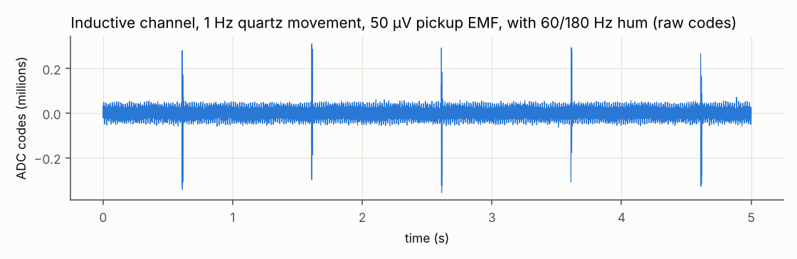
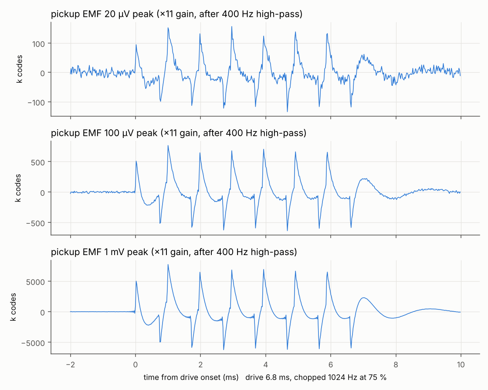
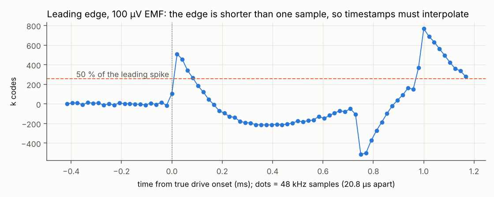
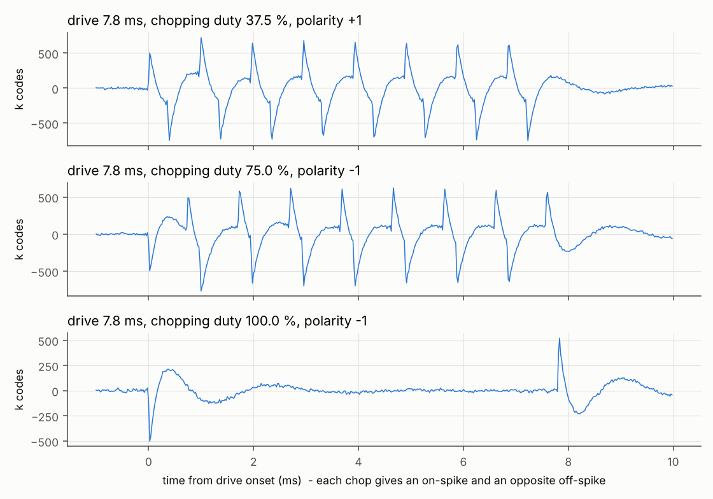
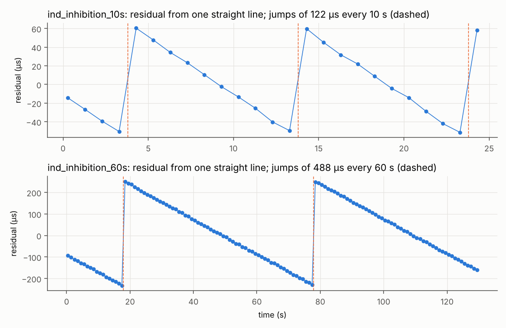
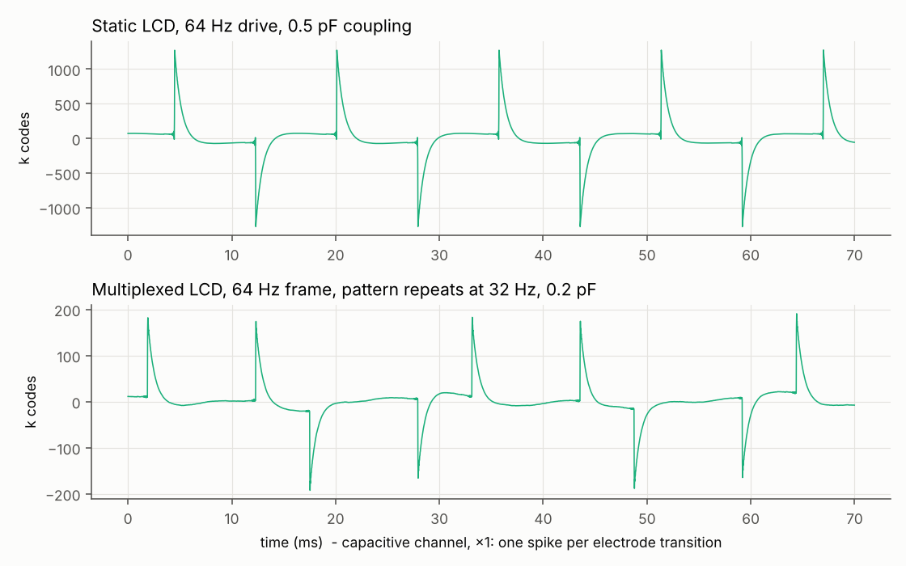
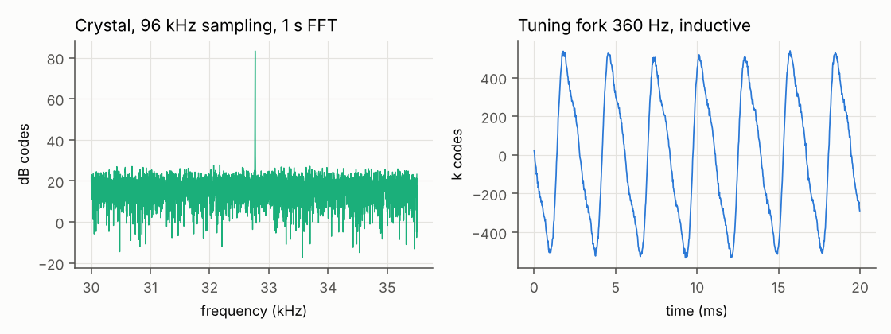

# Quartz / LCD pickup: firmware handoff

## 0. How to use this package (read first, agents included)

| Path | What it is | Use it to |
|---|---|---|
| `FIRMWARE_HANDOFF.md` | This document | Understand the signals and the timing method |
| `signal_spec.yaml` | Every number in this document, as data | Set constants and thresholds. Don't copy them out of the prose |
| `figures/*.png` | Sample waveforms drawn from the test vectors | See what the ADC will deliver |
| `vectors/*.wav` + `*.json` | Synthetic ADC captures with exact ground truth | Run acceptance tests (section 9) |
| `ref/timing_ref.py` | Reference algorithms (Python, numpy and scipy) | Treat as the executable spec. Port it, then compare outputs |
| `ref/run_tests.py` | Runs the reference against every vector | `python3 ref/run_tests.py vectors` |
| `gen/` | Channel model and vector generator | Regenerate or extend the vectors |
| `sim/` | Circuit netlists and the small SPICE-subset solver the channel model is built on | Re-run the circuit simulation if the board changes |
| `results.json` | Reference output for every vector | Use as the baseline your port must match |

Rules for an implementing agent:
1. Treat `timing_ref.py` as the specification. Where this document and the code disagree, the code was tested and wins. Report the disagreement.
2. A port is "done" only when it passes every row of the acceptance table in section 9.
3. Never resample or re-clock the ADC stream. The sample clock is GPS-disciplined, so `sample_index / fs` *is* the time base.
4. Constant delays (analog chain, ADC filter, your own filters) cancel out of every rate. Keep filters time-invariant. Don't apply a different filter to alternate pulses.

## 1. System summary

```
watch ──► L1 sense coil (inductive) ─► ×11 / ×1 preamp ─► OUT_IND ─► PCM1808 LEFT
      └─► capacitive electrode + guard ─► ×1 / ×11 buffer ─► OUT_CAP ─► PCM1808 RIGHT
                                               (L2 = hum-cancel coil in series with L1)
```

| Watch type | What is sensed | Channel | Time-domain feature | Method |
|---|---|---|---|---|
| Analog quartz (stepper motor) | Coil drive pulse, every 1–60 s | LEFT | Pulse leading edge | Event timestamps, regression (§4) |
| Analog quartz with inhibition | Same, plus periodic jumps of ≥61 µs | LEFT | Same | Segmented regression (§5) |
| LCD digital | Segment/backplane drive transitions | RIGHT | 16–128 Hz periodic spike pattern | Harmonic phase slope (§6) |
| Plastic-cased quartz | 32 768 Hz crystal field | RIGHT, fs = 96 kHz, JP2 bridged | Tone | Complex demodulation (§7) |
| Tuning fork (Accutron and similar) | Fork drive | LEFT | 300–720 Hz tone | Complex demodulation (§7) |

## 2. ADC interface

| Item | Value |
|---|---|
| Format | 24-bit two's complement, full scale ±8 388 607 codes = ±1.5 V |
| Codes per volt | 5 592 405 (2²³ / 1.5) |
| Sample rate | 48 kHz default. 96 kHz needed only for crystal mode |
| Usable bandwidth | 0.454·fs (21.8 kHz at 48 kHz) |
| Input coupling | AC, through the PCM1808's internal 2.5 V bias. Expect a small DC offset; high-pass it out |
| Constant delay | Analog ≈ 7.3 µs (simulated), plus the ADC filter's group delay (≈17.4/fs per datasheet; verify). Both cancel in rates |
| Jumper defaults | JP1 **bridged** (inductive ×11 → 60.8 dB). JP2 **open** (capacitive ×1). R8 and R15 not fitted |

Channel noise at the ADC (simulated):

| Channel | Setting | Noise (rms codes) | Clips at |
|---|---|---|---|
| LEFT | JP1 bridged | 10 215 (1.83 mV) | ≈1.4 mV pickup EMF |
| LEFT | JP1 open | ≈1 030 (est.) | ≈14 mV pickup EMF |
| RIGHT | JP2 open | 284 | not reached by LCD signals |
| RIGHT | JP2 bridged | 2 516 | LCD coupling > 0.33 pF |

The LEFT channel is noise-dominated at ×11 by design: input-referred noise is 1.7 µV rms, and real pulses are 20–1000 µV.

## 3. Signal catalogue

### 3.1 Stepper-motor pulses (LEFT)



| Parameter | Value | Source |
|---|---|---|
| Step interval | 1, 2, 2.5, 5, 10, 20, 30 or 60 s | Published movement data |
| Drive pulse width | Up to 20 ms, typically 3.9–7.8 ms | Published |
| Chopping | 1024 Hz, duty 37.5–100 % in 6.25 % steps (the IC varies duty to save energy) | Published |
| Polarity | Alternates every step. Absolute sign depends on how the watch sits | Physics |
| Pickup EMF, leading-spike peak | 20 µV weak, 50–300 µV typical, 1 mV close to the coil | Simulated / estimated |
| Peak at ADC (×11) | ≈6 080 codes per µV of EMF | Simulated |
| Leading-spike rise time | Under one sample at 48 kHz | Simulated |

What one pulse looks like at three amplitudes. The first spike marks the drive onset; each chopping cycle then adds an on-spike and an opposite off-spike:



The edge is faster than the sample interval, so timestamps must interpolate between samples. A simple "first sample over threshold" approach quantises to 20.8 µs and is not acceptable:



The drive shape changes from pulse to pulse as the IC adapts its duty. Only the **leading edge** is stable, so time from that edge:



Some calibres also produce **detection or correction pulses**: a larger, longer burst a few ms to tens of ms after a step the IC thinks was missed. Time only the first pulse of a group (the grouping in §4 does this), and log the extras as a fault indication.

### 3.2 Inhibition (affects motor timing only)

Most quartz watches are trimmed digitally. The crystal runs slightly fast, and every *P* seconds (typically 10 or 60 s, up to 960 s) the IC deletes *n* pulses at a divider stage, usually 8192 Hz. Each deletion delays the next motor step by n × 122.07 µs. The result is a sawtooth in the timestamps:



The two numbers to report are:
- **rate without inhibition**: the slope within a segment, i.e. the raw oscillator. It is useful for diagnosing the crystal.
- **rate with inhibition**: the mean over whole inhibition cycles. This is what the wearer sees and is the headline figure.

### 3.3 LCD (RIGHT)



| Parameter | Value |
|---|---|
| Waveform | One spike per electrode transition (a differentiated square wave), decaying in about 1 ms |
| Pattern repeats at | 64 Hz for static drive. Typically 32 Hz for multiplexed drive. Candidates: 16, 32, 64, 128 Hz |
| Coupling | 0.05 pF weak, 0.2 pF typical, 0.5 pF strong |
| Spike peak (JP2 open) | ≈150 k codes at 0.05 pF static; ≈1.3 M codes at 0.5 pF static; ≈190 k codes multiplexed at 0.2 pF |
| Inhibition | Not visible. The LCD runs from the divider before the trimming. The LCD rate is the oscillator rate |

### 3.4 Tones



| Source | Frequency | Level at ADC | Notes |
|---|---|---|---|
| 32 768 Hz crystal | 32 768 Hz | ≈2.8 mV (estimate) | Plastic cases only. Needs fs = 96 kHz and JP2 bridged. Low confidence until measured |
| Tuning fork | 300, 341.33, 360, 480 or 720 Hz | Tens of mV, with harmonics | Gate ≥ 8 s |

## 4. Motor-pulse timing algorithm

Reference functions: `detect_motor_pulses`, `timestamp_pulses`, `motor_rate`.

```
STREAM PROCESSING (per sample, LEFT channel)
  y = HPF_400Hz_4th_order_Butterworth(x)      # removes 60/180 Hz hum and DC; time-invariant
  sigma = robust noise estimate, updated in quiet periods only
          (1.4826 * median|y|, or a running mean-absolute value * 1.25)
  thr = 8 * sigma
  if |y| > thr and no detection in the last 50 ms:
       start a PULSE GROUP at sample i_first
  a group ends after 50 ms with |y| < thr

PER PULSE (on a buffer from -0.2 ms to +0.3 ms around the leading spike)
  i_peak    = argmax |y| in the first 0.3 ms after i_first
  polarity  = sign(y[i_peak])
  timestamp = leading-edge time, sub-sample, by ONE of:
     (a) RECOMMENDED: cross-correlate the window (multiplied by polarity) with a template.
         Template = average of the first N pulses, aligned. Find the correlation peak to a
         fraction of a sample (FFT zero-padding or a parabolic fit on an upsampled
         correlation). Window -0.2..+0.3 ms stays inside the first chop even at 37.5 % duty.
     (b) SIMPLE: 50 % of the leading spike's peak, with linear interpolation between the
         two samples that straddle it.
     On the test vectors both methods pass and neither wins consistently on noise
     (results.json). (a) halves the error at high SNR and copes better with shape changes;
     (b) is far cheaper. Either is acceptable; implement (b) first.
  record (t, polarity)

RATE (after K >= 3 pulses; see motor_rate)
  step = the allowed interval nearest to median(diff(t))
  n_k  = round((t_k - t_0) / step)                       # step number; tolerates missed pulses
  dev_k = diff(t)_k - diff(n)_k * median interval
  inhibition events = k where dev_k > 20 us
  segment id s_k increments after each event
  least squares:  t_k = a[s_k] + b * n_k + c * polarity_k
        a[s] = one intercept per segment, b = common period, c = polarity offset
  rate_without_inhibition = 86400 * (step / b - 1)
  if >= 2 inhibition events:
      i = first pulse after the first event
      j = first pulse after the last event with the same polarity as i
      T = (t_j - t_i) / (n_j - n_i)
      rate_with_inhibition = 86400 * (step / T - 1)
      inhibition_period = median spacing of events * step
  else:
      rate_with_inhibition = rate_without_inhibition, with a warning flag
```

Why each step is there:
- **The polarity term `c`.** Alternate pulses drive opposite coil halves, and their edges can differ by a constant amount. Without `c`, that difference leaks into the slope when the pulse count is odd.
- **Segmenting at inhibition jumps.** A single straight line through a sawtooth is biased by wherever the gate starts and stops. Separate intercepts make the slope exact.
- **The 20 µs threshold.** The smallest real jump is 61 µs (one pulse at 16 384 Hz). Timing noise is 0.01–2.6 µs rms.
- **Step numbers instead of counting pulses.** A missed detection then costs nothing.

Firmware notes:
- Cross-correlation is needed only on 0.5 ms windows (24 samples at 48 kHz). The template can be fixed after the first 4 pulses.
- Display a provisional rate after 3 pulses, then refine.
- For gating, show "inhibition cycle not yet seen" until the second event. The user should be able to pick a gate: 10 s, 60 s, or "until 2 events".

## 5. Inhibition handling summary

| Situation | What to show |
|---|---|
| No jump seen, gate ≥ 2 × the longest expected period | Rate (no inhibition detected) |
| No jump seen, short gate | Raw rate, flagged "may include inhibition". Offer a longer gate |
| One jump | Raw rate plus a "need one more cycle" status |
| ≥ 2 jumps | Corrected rate as the headline; the raw rate, the period and the jump size in µs as details |

The jump size divided by 122.07 µs gives n at 8192 Hz. Show it: watchmakers use it.

## 6. LCD timing algorithm

Reference: `lcd_rate`, `lcd_period`, `harmonic_phase_rate`.

```
y = HPF(x, 400 Hz)
pattern rate f0 = the highest of {128, 64, 32, 16} Hz where the normalised
                  autocorrelation at lag fs/f0 exceeds 0.8 (2 s of data)
pick harmonics k (k*f0 <= 2.5 kHz): the 4 strongest bins of a Hann-windowed FFT
for each 0.5 s block b:
    for each chosen k:  Z[b,k] = Goertzel/single-bin DFT of the Hann-windowed block at k*f0,
                       with the phase referenced to absolute sample time
phase_k(b) = unwrap(angle(Z[b,k])) / k
slope_k    = least-squares slope of phase_k against block centre time
eps  = weighted mean of slope_k (weights k) / (2*pi*f0)
rate = 86400 * eps
```

Using the harmonics rather than the fundamental is deliberate. The spikes put almost all their energy at kHz harmonics, and the fundamental is buried in hum. Keep k·f0 ≤ 2.5 kHz so that ±100 ppm moves the phase by less than half a cycle between blocks. The phase then unwraps reliably.

## 7. Tone timing (crystal, tuning fork)

Same maths with k = 1 at the nominal frequency: `tone_rate(x, fs, f_nom, block_s)`. Use blocks of 0.05 s for the crystal and 0.25 s for a tuning fork. Rate = 86400 · (f_meas/f_nom − 1). The crystal shows the oscillator **before** inhibition.

## 8. Pitfalls checklist

- [ ] **Unknown polarity.** Never assume the first pulse is positive. Detect on |y|.
- [ ] **Hum.** 60/180 Hz at mV level. The 400 Hz high-pass is mandatory before thresholding.
- [ ] **Clipping.** If |x| ≥ 8 388 607 on a pulse, flag it and suggest opening JP1. Timing still works on the vectors (0.02 µs error), but the duty/width estimates fail.
- [ ] **Weak signals.** Below about 30 µV EMF, jitter exceeds 2 µs per pulse. The rate is still fine over 60 s (about ±0.0007 s/d per µs of per-pulse jitter, for 60 pulses at 1 s), but tell the user to reposition the watch.
- [ ] **The LCD channel cannot see inhibition**, so LCD and motor rates on the same watch can legitimately differ.
- [ ] **Detection and correction pulses.** Ignore extras inside a group. Log them.
- [ ] **Gate length.** A 10 s gate on a 60 s-inhibition watch reports the raw rate. Always surface the status from §5.
- [ ] **Sign convention.** Positive means gaining. Both formulas above give the same sign.
- [ ] **Duty and drive-width estimation** (`drive_shape`) is informational only and **not reliable** in the reference below ~200 µV EMF or at 100 % duty. Do not gate any timing decision on it. It is an open item (§10).

## 9. Acceptance tests

Run the port on each vector (LEFT for `ind_*`, RIGHT for `lcd_*` and `xtal_*`), then compare with `expected` in the JSON. Reference results come from `results.json` (generated by `ref/run_tests.py`).

| Vector | Expected (truth) | Reference result | Pass if |
|---|---|---|---|
| ind_pulses_20uV | 3 pulses, edge jitter | 2.6 µs rms | Count exact; jitter ≤ 4 µs |
| ind_pulses_100uV | 3 pulses | 0.25 µs rms | Count exact; jitter ≤ 0.5 µs |
| ind_pulses_1mV | 3 pulses | 0.01 µs rms | Count exact; jitter ≤ 0.1 µs |
| ind_pulses_2p5mV_clipping | 3 pulses, clipped | 0.02 µs; clip flag set | Count exact; clip flag set |
| ind_duty_sweep | 12 pulses, duty 37.5–100 % | 0.29 µs rms | Count exact; jitter ≤ 0.6 µs |
| ind_rate_no_inhibition | −0.432 s/d | −0.4315 | ±0.01 s/d |
| ind_inhibition_10s | Raw +1.2096, corrected +0.1549, period 10 s | +1.2119 / +0.1570 / 10 | ±0.01 raw, ±0.02 corrected, period exact |
| ind_inhibition_60s | Raw +0.9031, corrected +0.2000, period 60 s | +0.9022 / +0.2059 / 60 | ±0.01 raw, ±0.02 corrected, period exact |
| ind_step_20s | +0.5 s/d, step 20 s | +0.4977, step 20 | ±0.01; step exact |
| ind_tuning_fork_360Hz | +0.5184 | +0.5185 | ±0.005 |
| lcd_static_64Hz | +0.2592, 64 Hz | +0.2592, 64 | ±0.005; f0 exact |
| lcd_multiplex_32Hz | −0.6912, 32 Hz | −0.6914, 32 | ±0.005; f0 exact |
| lcd_weak_static_64Hz | +0.0864, 64 Hz | +0.0865, 64 | ±0.005; f0 exact |
| xtal_32768Hz_96k (fs 96 kHz) | +0.9031 | +0.9032 | ±0.005 |

Vector file layout:
- Stereo, 24-bit PCM. L = OUT_IND, R = OUT_CAP.
- 48 kHz, except the crystal vector, which is 96 kHz.
- Each JSON holds `description`, `events[]` (`t_onset_s`, `polarity`, `pulse_width_s`, `duty`), `inhibition` (period and per-event delays), `expected{}`, peak codes and the assumed jumper settings.
- Every vector includes the simulated noise of the channel. Most include hum.

## 10. Provenance, confidence and open items

| Item | Confidence | Basis |
|---|---|---|
| Gains, bandwidth, noise, delays | Medium–high | SPICE-subset simulation with TLV9062/OPA2376 macromodels, checked against the datasheets |
| Pulse shape at the ADC | Medium | Motor-coil model (2 kΩ, 1 H, 1.55 V), chopped drive, filtered through the simulated transfer function. Within 0.3 % of a SPICE transient |
| Pickup EMF levels (µV) | **Low** | Coupling estimate. The first board measurement will reset these. Keep thresholds noise-relative, as in §4, not absolute |
| LCD coupling (pF) | Low–medium | Estimate. The algorithm does not depend on the level |
| Crystal mode | **Low** | Depends heavily on the case and on how the watch is placed |
| Inhibition parameters | High | Published IC behaviour |

Open items for the firmware owner:
1. Capture real watches once the board is built. Save them in the same WAV+JSON layout and add them to the acceptance set.
2. Replace the reference `drive_shape` with a robust duty and width estimator if the UI needs it (e.g. for a "battery end-of-life" indication from the drive level).
3. Confirm the PCM1808 group delay. It is only needed to display absolute phase, never for rate.
